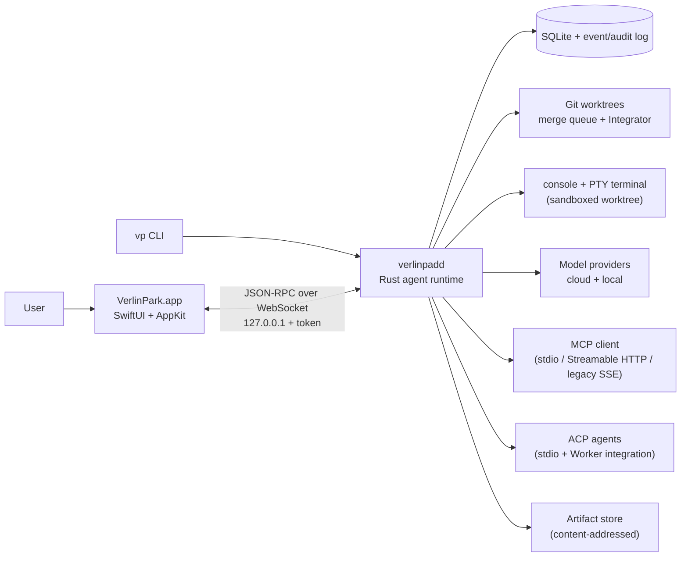

# VerlinPark

**A native macOS agentic development environment for agent teams.**

VerlinPark runs a hierarchy of coding agents in isolated Git worktrees, lets Managers compare plans before work starts, and makes every plan, tool call, diff, token, and permission decision inspectable and traceable. A session-scoped typed peer mailbox and text/binary artifact store with retention GC are available to agents, the Preview, RPC, and the CLI.

> **Status: M2 four-tier delegation + M3 merge queue/conflict-resolve/landing/PR/pause-resume/shell-sandbox + project knowledge/skills/artifact versions + cache-aware long-task telemetry/steering/progress observability + policy-gated stall recovery/deferred continuations + evidence-backed memory v2/long-task operator console + memory conflict review/health/verifier capture.** The daemon, CLI, SQLite event log, provider adapters, and native SwiftUI shell run end-to-end. A session Leader can plan and delegate through Manager → Worker → Labour, convene a read-only Manager roundtable, auto-dispatch a validated TeamPlan in dependency batches, isolate Workers in Git worktrees, gate merges on a Verifier verdict, and pass approved commits through a persisted merge queue and a deterministic Integrator (merge, diff check, optional project check, rollback on failure). Conflict/failed/interrupted entries can be rebased and retried, or a conflict can be explicitly auto-resolved by a resolver agent and re-verified, with an opt-in project policy for automatic resolution after a session goes idle; a clean checkout can be explicitly landed into the default branch, or pushed and opened as a GitHub PR via `gh`. Sessions have approvals, cooperative pause/resume, cancellation, a live diff, an event trace, a per-call usage ledger, and a session-scoped typed mailbox and content-addressed, zstd-compressed text/binary artifact store with replayable publish/prune events, both with project retention GC; role models and USD prices are user-configured; sessions support token, USD, and wall-clock budgets, and Projects can set a shared token/USD pool across sessions, TeamPlans can narrow those with per-department and per-task budgets, and concurrent calls reserve that capacity atomically before they start. A session can instead be created in an explicit **unlimited budget mode**, or toggled into it while running (`vp session-unlimited`, the Stage session menu, `session.budget.set`); this bypasses session, task, department, and project economic gates while capacity, approvals, verification, context, and turn limits remain active. A daemon-wide session semaphore queues excess runs (`queued`), plan tasks persist with priority, dependency, attempt, and scope state, cross-session Worker write scopes wait on SQLite-backed global write leases instead of racing, and daemon-wide Worker/Labour capacity caps stop each session from multiplying the per-session batch. A project-level auto-resume policy can pick idle/failed sessions with pending tasks by effective priority, aging, and session round-robin; queued tasks can be skipped, retried, paused, resumed, or cancelled explicitly. A project task inbox and default-on autonomous dispatcher now run standalone intake items through synthesized one-task TeamPlans with dependency gates, atomic claims, retry reconciliation, and scheduler observability. A project knowledge library indexes notes, project files, imported folders, and public pages into durable snapshots and heading-aware chunks; agents retrieve them with `search_sources` / `read_source`, and exact `[cN]` citation evidence is attached to `agent.message` events, inspected in Preview Sources → Citations, and available through `session.citations`. Project skill packs are imported from `SKILL.md` or authored in Settings, injected only as a bounded catalog, activated with `use_skill`, and can only narrow the role's tool allow/deny policy; successful activations are event-backed. Sources can be grouped into collections and filtered by collection/label in both lexical search and the agent tool, and `session.citation_audit` exposes dangling `[cN]` markers and unused citation records for review. Inline artifacts have version history, restore, and a bounded line diff plus session-scoped request-key idempotency; binary artifact preview beyond the 1 KB hex dump, default-on conflict resolution without a project opt-in, and full shell read/network confinement are **not** implemented yet; shell writes, common credential reads, and process groups are constrained by the runtime sandbox, and projects can deny shell network access, add read-deny paths, restrict HOME, or opt into a broader user/volume read jail — see [PROGRESS](docs/PROGRESS.md) and [AUDIT](docs/AUDIT.md).

---

## Why another ADE?

Coding agents are powerful, but the workflow around them is still held together with terminal tabs, copy-pasted prompts, and hope.

- Multiple agents edit the same checkout and step on each other.
- Context is trapped in one chat window; subagents become a game of telephone.
- Token spend and tool activity are invisible until the bill arrives.
- Every agent vendor wants to own the workflow.
- Local models are treated as a second-class option.

VerlinPark is built around a different default: **agent teams should have an org chart, isolated workspaces, and a paper trail.**

It is not a chat window bolted onto an editor. It is a native control plane for planning, running, reviewing, and landing agent work.

## The three pillars

### 1. Park — a workspace for agent teams

Every task gets a Git worktree and a branch. Every manager owns a workstream. Every agent gets a role, a model, a budget, and a permission policy.

The default organization is a four-tier structure:

```text
Leader (1)
├── Managers (4 default, max 5)        discuss, produce outlines, assign work
│   ├── Workers (6 default, max 10)    execute tasks, own worktrees, hire Labour
│   │   └── Labour (12 default, max 40) assist with subtasks
```

Plan Worker auto-expansion is opt-in and budget-gated; Managers are created lazily when a department has ready work. General Manager/Labour expansion and scale-down remain future work.

Plans are proposed by the Leader, validated by code, and executed in dependency batches. Managers can exchange positions in a bounded roundtable; agents exchange durable typed messages and text artifacts through the session mailbox.

### 2. Glass Box — everything is inspectable

VerlinPark records the full session as an append-only event log:

- the plan and every revision
- every agent message, including who asked whom for what
- every LLM request and response
- every tool call, approval, and diff
- tokens, cost, latency, retries, and budget state
- every Git worktree, commit, merge queue entry, and Integrator result

The UI can inspect a session and show exactly why a change was proposed. `vp replay` checks critical projections against the event stream, `vp replay --repair/--rebuild` rebuilds the covered fields, and `vp export` writes a portable session bundle; `vp import` restores it as a read-only archive (including approvals), and `vp rehydrate` explicitly recreates a worktree to make it runnable. See [AUDIT](docs/AUDIT.md).

### 3. Open Bench — native, local-first, and extensible

- Native SwiftUI/AppKit UI, not a web app in a shell.
- Glass Park shell: project rail, chat stage, live team graph (Collab), Preview studio, Manage Dash.
- Knockout wordmark: solid, gradient, or a region/pride flag showing through the letters; 248 regions and 20 pride flags.
- A Rust core daemon that can run headless and be driven by a CLI.
- Cloud APIs first; any OpenAI-compatible endpoint (LM Studio, Ollama, llama.cpp) works as a local provider.
- Embedded MLX runtime planned for a later milestone.
- MCP tools over stdio, Streamable HTTP, and legacy HTTP+SSE, plus external Agent Client Protocol (ACP) agents, are implemented; skills and hooks remain planned.
- A sandboxed local WKWebView `browser` helper for localhost/worktree UI verification, serialized by a daemon-wide `ComputerLease`; native macOS computer control is still planned.
- Cache-aware long-session telemetry: provider cache read/write tokens, per-role cache prices, stable-first prompt prefixes, frozen tool bundles, and a Preview Cost hit rate. Operators can steer a running Leader or Worker at the next provider boundary and inspect thresholded task stall observations without auto-killing long work.
- Policy-gated stall recovery (`observe` by default; opt-in `escalate` or bounded `retry`) and deferred session continuations that wake on watched plan tasks or a deadline, then start through the normal gated run path.
- Evidence-backed project memory: commit/path/task/session provenance, deterministic FTS+structural ranking with explainable scores, TTL verification plus an opt-in stale sweep, pin/supersede lifecycle, and automatic task-result/Verifier/integration memories that supersede on retry. Deterministic same-scope conflict review and a project memory health view make disagreement and verification debt inspectable. No embeddings, no hidden model routing.
- Verifier verdicts are knowledge, not just gate transitions: approvals, rejections, and successful conflict resolutions become project memories with task/session/commit evidence. The memory health card exposes coverage, verification due, and open conflicts; resolution is always an explicit operator action.
- A long-task operator console in the macOS app: session-scoped steering, continuation, stall-recovery, and task-progress cards, plus Stage steer/defer sheets. Every action calls the real daemon RPC and surfaces its error.
- GPL-3.0, open protocols, no vendor lock-in.

> **Aviiya is external.** The resident assistant surface is reserved for a future
> [NovaBAIC](https://github.com/Verlintas/NovaBAIC) bridge. VerlinPark does not implement a
> local Aviiya persona or memory.

### Keyboard and command palette

- `⌘K` — command palette: projects, all sessions, actions, settings, focus mode.
- `⇧⌘F` — focus mode (hide rail and studio); `⌘K` can toggle it too.
- `⌘F` — search messages and events; `⌘R` — refresh the active surface.
- `⇧⌘O` — add project; `⌘N` — new session; `⇧⌘D` — Manage Dash.
- `⌘1` — chat with the external Aviiya bridge; `⌘L` — focus the message composer.
- `⌘/` — keyboard shortcut reference; `esc` dismisses overlays.
- In Manage Dash, `⌘1–⌘9` switch sections; in Settings, `⌘1–⌘7` switch sections.
- The top chrome exposes connection state, breadcrumb, memory, notifications, command palette, shortcuts, and focus mode.
- Session/provider/MCP/ACP/landing/PR/checkpoint actions surface transient toasts; the Rail notification center remains the durable inbox.

## Architecture at a glance



The daemon owns sessions and keeps running when the app closes. The SwiftUI app is a client. The CLI is another client. The protocol is versioned; session replay/repair covers critical projections, but this is not full event sourcing yet.

## Toward v0.1

The first end-to-end demo is a complete multi-agent feature delivery on a benchmark repository:

1. Open a repository and create a session with a goal.
2. Pick a four-tier org preset. Assign models and budgets manually.
3. The Leader produces a plan; the runtime validates the DAG, scope syntax, fan-out, and budget.
4. Departments execute tasks in parallel, each Worker in its own worktree.
5. A read-only Verifier runs tests and submits a verdict.
6. The Integrator merges approved work into the session branch; the UI shows the plan, messages, tool calls, diffs, queue state, and token usage.
7. The user reviews and lands the integration branch.

**Today:** steps 1–5, the merge queue, and the deterministic Integrator work with a base model, per-role model overrides, and session token/USD/time budgets; the Manager roundtable, task worktrees, and Verifier gate are real. Plan tasks persist across runs in a global DAG queue with priority/aging, tasks can be inspected or skipped/retried with `vp tasks` / `vp task-skip` / `vp task-retry`, the project scheduler can resume a stored plan or dispatch one ready task per tick (`vp task-dispatch` runs one immediately), and Write leases are SQLite-backed; MCP supports stdio, Streamable HTTP, and legacy HTTP+SSE with session/protocol headers, same-origin redirects, `${ENV_VAR}` header indirection, transport-aware probe, and capability-filtered propagation to ACP agents; batches only group non-overlapping write scopes (unscoped tasks serialize), and the token budget uses pre-flight reservations. Long top-level sessions derive context limits from a configurable model window (128k default; per-role overrides), compact at 75% of the usable window into a persisted summary, and roll older messages out at safe boundaries if summarization fails or the hard limit is still exceeded, while keeping the original messages for search and audit. `vp context <session>` and the Stage header show active context, threshold, hard limit, the latest summary/trim, and the last provider estimate-vs-actual measurement; provider usage applies an upward-only, model-scoped calibration to later context decisions, and an idle session can be compacted explicitly with `vp compact <session>` or the Stage context popover, and a session worktree (clean or dirty) can be snapshotted and forked with `vp checkpoint` / `vp fork` or the Stage session menu; ignored files are excluded and the source index/HEAD are not modified. Checkpoints can be deleted or pruned with `vp checkpoint-delete` / `vp checkpoint-prune` or Manage Dash; deletion tombstones the checkpoint and releases its snapshot ref without touching existing forks. A per-project opt-in retention policy (`vp checkpoint-policy-set`, Manage Dash) and the `VERLINPARK_CHECKPOINT_SWEEP_SECS` daemon sweep can prune older checkpoints automatically while keeping the latest N. `vp lineage` / Manage Dash shows parent, sibling, and child forks, and `vp compare` / the Fork lineage Compare sheet returns committed branch stats and a capped unified patch. `vp fork-merge` / Manage Dash Fork lineage Merge brings a direct child fork's committed branch back into a clean source with conflict/failed-check rollback. `vp fork-tree` / Manage Dash Tree shows the recursive fork family; `vp fork-forest` / `vp fork-audit` / `vp fork-repair` cover the whole project and checkpoint refs, and `vp checkpoint-stats` reports approximate storage. Settings → About provides a manual `update.check` and a SHA-256-verified `update.download` to `~/Downloads` (no automatic installation), and Settings → Providers manages secret-free model presets for role metadata. Manage Dash uses a sidebar with overview, inbox, team/tasks, usage, git/forks, checkpoints, storage, policies, and diagnostics, plus project/session pickers, an agent roster, a cross-project `dashboard.snapshot` / `vp dashboard` with needs-attention alerts, and checkpoint diff/restore (`vp checkpoint-diff` / `vp checkpoint-restore`) for quiescent sessions, with a clean-worktree requirement for restore. The autonomous dispatcher is default-on for new projects: it resumes stored plans, and standalone task-inbox items become validated one-task plans (with project-level intake dependencies, atomic claims, attempt/backoff reconciliation, and a per-project intake cap). Users can pause intake or disable the scheduler per project; `vp scheduler` and Manage Dash report live occupancy and policy. `vp sources` / `vp source-add-*` / `vp source-collections` / Preview Sources manage the project knowledge library; `vp session-new --unlimited` and `vp session-unlimited` control the session budget mode; `vp skills` / `vp skill-import` / `vp skill-activations` / Settings → Skills manage skill packs and activation history; artifact cards expose version history, restore, and a bounded line diff (`vp artifact-diff`); `vp citation-audit` reports dangling and unused citation evidence. Knowledge retrieval is deterministic FTS5 plus a literal fallback, not an embedding index, and source refresh keeps citation excerpts but not old full chunks. **Still planned:** compaction checkpoint/resume, optional LLM Integrator, default-on auto-resolution, durable cross-process session leases, native macOS computer control, a distributed/fair ComputerLease, and ACP HTTP/SSE transport, session resume, and auth flow. Opt-in auto-resolution with attempt/token caps is available. Local landing and `gh` PR flow are available. External stdio ACP agents can be configured and delegated as Workers; their permission requests use the risk-based approval policy, and their commits go through the same Verifier/merge queue. v0.1 is not a full IDE, not a model hub, and not a document workspace. See [docs/PLAN.md](docs/PLAN.md) for scope, milestones, and non-goals.

> Known gaps at this milestone: shell writes are confined to the worktree, Git metadata, and runtime scratch; common credential/state paths are read-denied and shell process groups are killed on timeout/cancel; projects can deny shell network access, add read-deny paths, restrict HOME, or deny sibling user homes and volumes with the opt-in read jail, but system paths, arbitrary reads outside those roots, network under allow, and daemon-mediated writes are not confined; Verifier runs in an isolated detached clone of the Worker commit and rejects tracked-file edits after the run, so it cannot mutate the Worker worktree/branch, but it is not a full network/filesystem sandbox; external ACP agents run in the shell write sandbox with a scratch HOME but are trusted binaries and are not credential/network-isolated; the browser is a WKWebView helper under a write-confined Seatbelt profile with a daemon-wide ComputerLease, but page JavaScript is not network-isolated, it needs a logged-in GUI session, snapshots are DOM-derived, screenshots are viewport-only, and the lease is single-daemon with no queue or fairness policy; the event log can verify/repair/rebuild critical projections including the agent roster and export a bundle; import is a read-only archive until `vp rehydrate` explicitly recreates the session worktree and remaps imported agent task-worktrees by branch; conflict resolution is an explicit agent-assisted action or an opt-in per-project policy; default-on auto-resolution is not implemented, and the PR flow uses `gh` for GitHub or `glab` for GitLab. Provider streams retry transient startup failures and retry a stream only before any text/tool output; a mid-stream break preserves partial output and usage but cannot resume from the break point. Standalone intake is dispatched through a synthesized one-task TeamPlan; per-task dispatch of a stored plan still runs at most one plan task per session at a time in that mode, and the session run map is process-local rather than a durable cross-process lease. Source retrieval is lexical (FTS5 + LIKE), not semantic; PDF/OCR/audio/connector ingestion is not implemented; refresh replaces current chunks and keeps citation excerpts rather than full historical revisions. Collections and labels are organizational filters, not authorization boundaries. The citation audit checks key presence, not whether prose is actually supported by the cited chunk. Unlimited budget mode is an explicit economic-gate bypass, not a safety bypass; a single unlimited session can also bypass a project shared budget, and very long runs can consume substantial spend without an automatic cap. Skills are user-approved prompt/policy data, not a malicious-content sandbox, and only one skill is active at a time. Inline artifact diff is line-level text (Myers with a bounded edit/output budget); binary artifacts remain immutable and cannot be diffed, and cross-process request-key atomicity is not claimed. Context compaction runs before each top-level provider call, can omit details from the summary, and its rolling-trim fallback can drop messages not covered by the summary; it is not a checkpoint or provider-native context manager. Correct context-window values are user-configured, so a wrong value can still cause early compaction or provider overflow. Steering is cooperative only (next provider boundary; it cannot interrupt an in-flight provider/tool call), and undelivered steering is cancelled when its run ends. `plan_task_progress` is operational observation state, not replay-grade state. Stall recovery is opt-in and same-task/department, not immutable same-agent resume; it cannot interrupt a provider stream that never reaches a turn/tool boundary, and failures escalate instead of looping. Deferred continuations are operator-only session-level wakeups, not recurring workflows or cross-process leases; a row already `delivering` when the daemon restarts is failed closed rather than started twice. Cache pricing is user-configured; the runtime does not infer provider discounts. See [docs/AUDIT.md](docs/AUDIT.md).

## Documentation

Start with the [documentation index](docs/README.md). The short version:

- [Progress](docs/PROGRESS.md) — what actually works today (source of truth)
- [Audit](docs/AUDIT.md) — known gaps, evidence, and recommended order
- [Architecture](docs/ARCHITECTURE.md) — target runtime, protocol, data model, security
- [Development plan](docs/PLAN.md) — product thesis, scope, milestones, risks
- [Decisions](docs/DECISIONS.md) — locked architectural decisions (ADRs)
- [Research](docs/RESEARCH.md) — competitive analysis and sources (historical)
- [Third-party notices](THIRD_PARTY_NOTICES.md) — bundled FlagKit assets (MIT)
- [Pride flag sources](docs/PRIDE_FLAGS.md) — Wikimedia Commons file/author/license table

## Build and run

Requirements: macOS 15+, Xcode 27+, Rust stable, [XcodeGen](https://github.com/yonaskolb/XcodeGen), [`just`](https://github.com/casey/just).

```bash
just bootstrap
just test
just run
just package   # release app + DMG under dist/
```

`just package` builds a Release app, bundles `verlinpadd`, ad-hoc signs the
bundle, stages `verlinpadd`/`vp`/docs, and writes a `dist/*.dmg` plus SHA-256.
Developer ID signing/notarization is explicitly deferred; no Apple Developer
account is required. The optional env hooks (`VERLINPARK_SIGN_IDENTITY`,
`VERLINPARK_NOTARY_PROFILE`) remain for later, but are not the supported path.
Set `HOMEBREW_TAP_REPO` (`owner/repo`) and `HOMEBREW_TAP_TOKEN` to publish the
cask to a real tap. There is still no Sparkle auto-updater.

Configure a model in **Settings → Providers** (and adjust the per-session Manager/Worker/Labour caps under Team capacity) (any OpenAI-compatible endpoint, including LM Studio/Ollama/llama.cpp, or Anthropic). External stdio ACP agents are configured under **Settings → ACP** or with `vp acp-add`; `vp acp-probe` checks the handshake, and `delegate_acp` lets a Leader or Manager use a configured agent as a Worker. The API key is stored in Keychain and sent only to the local daemon. For headless runs, set `VERLINPARK_BASE_URL` and `VERLINPARK_MODEL` (plus `VERLINPARK_API_KEY` if needed). Set `VERLINPARK_INTEGRATION_COMMAND` to add a project-specific post-merge check (for example `cargo test`); without it the Integrator still runs `git diff --check`. `VERLINPARK_GLOBAL_SESSION_CAP` bounds concurrent session runs across the daemon (default 4, range 1–32); excess prompts queue as `queued`. `VERLINPARK_GLOBAL_WORKERS` (default 12) and `VERLINPARK_GLOBAL_LABOUR` (default 24) bound Worker/Labour runs across all sessions; the snapshot is available in Settings and `agent.info`. `VERLINPARK_AUTO_EXPAND_WORKERS` (or the Settings toggle) lets a TeamPlan expand Workers up to 10 when at least 20% of the session token budget remains. Plan tasks and global write leases are persisted; `vp tasks` (or `task.queue`) shows the queue and active leases. The autonomous dispatcher is default-on for projects without an explicit policy; `VERLINPARK_TASK_SCHEDULER=0` is the global opt-out, and the normal switch is the per-project `TaskSchedulerPolicy` (Manage Dash or `vp task-scheduler-set`). `VERLINPARK_TASK_SCHEDULER_SECS` (default 5) controls the scheduler tick; each project controls its own cooldown. Session priority is set with `--priority` (or the New Session picker); `VERLINPARK_PRIORITY_AGING_SECS` (default 60; 0 disables) raises low-priority waiters one point per interval up to +100 so they cannot starve forever. `VERLINPARK_WORKTREE_SWEEP_SECS` (default 3600; 0 disables) controls the opt-in per-project worktree retention sweep. `VERLINPARK_TASK_STALL_SECS` (default 1800; 0 disables) controls the plan-task stall sweep; `vp task-stalls <session>` and `session.stalls` show progress and stall events. Stall recovery is opt-in through the project `OrchestrationPolicy`: `stall_recovery=observe|escalate|retry`, `stall_min_observations`, `stall_max_attempts`, and `stall_grace_secs`; `VERLINPARK_STALL_RECOVERY_TICK_SECS` (default 30; 0 disables the reconciler) controls recovery progress. `vp recoveries <session>` shows recovery intents. `vp steer <session> "text" [--agent <id>] [--task <id>]` queues an operator instruction for a running Leader/Worker; delivery happens at the next provider boundary, and `vp steering <session>` lists pending/delivered/cancelled rows. `vp defer <session> "prompt" [--watch <task-id> ...] [--watch-mode all|any] [--after-secs N | --at RFC3339]` records a deferred continuation, `vp continuations <session>` lists them, and `vp continuation-cancel <id>` cancels a pending/ready row; `VERLINPARK_CONTINUATION_RETRY_SECS` (default 15) controls start-retry backoff. `VERLINPARK_PROVIDER_IDLE_SECS` (default 300, range 10–3600) bounds the wait between provider stream events. `VERLINPARK_CONTEXT_WINDOW` (default 128000; 0 disables automatic context management) is the base model window; a per-role `context_window` overrides it. The runtime reserves output, system, and tool-schema tokens, compacts at 75% of the remaining window, and falls back to safe rolling trims. `VERLINPARK_COMPACT_AFTER_TOKENS` (default 0 = derive from the window) is an explicit threshold override, and `VERLINPARK_COMPACT_KEEP_MESSAGES` (default 8) controls recent messages retained outside the summary. Live provider tests are opt-in: `OPENAI_API_KEY=... cargo test -p vp-providers --test live -- --ignored --nocapture` (Anthropic uses `ANTHROPIC_API_KEY` / `ANTHROPIC_MODEL`, local endpoints use `VERLINPARK_LIVE_BASE_URL` / `VERLINPARK_LIVE_MODEL`). `VERLINPARK_QUESTION_TIMEOUT_SECS` (default 1800, range 60–86400) bounds a blocking `ask_user` question. Agent web search is explicit and opt-in: set `VERLINPARK_SEARCH_PROVIDER=searxng|brave|tavily`, `VERLINPARK_SEARCH_ENDPOINT` (required for SearXNG, optional override for others), `VERLINPARK_SEARCH_API_KEY` (Brave/Tavily), and optionally `VERLINPARK_SEARCH_LANGUAGE`, `VERLINPARK_SEARCH_SAFE`, `VERLINPARK_SEARCH_TIMEOUT_SECS`. `lsp_query` uses installed language servers discovered on `PATH` (rust-analyzer, sourcekit-lsp, typescript-language-server, pyright/pylsp, gopls, clangd); it never auto-installs one. `read_pdf` extracts bounded PDF text and metadata, `read_image` reads dimensions plus optional tesseract OCR confidence, `read_document` extracts bounded DOCX/PPTX/XLSX/ODF text, and `data_query` applies a deterministic path subset to JSON/YAML/TOML/CSV. `browser` drives a daemon-launched WKWebView helper through a daemon-wide `ComputerLease`; it is limited to localhost HTTP(S) and worktree `file:` pages, uses a non-persistent WebKit store, returns DOM-derived snapshots, and saves viewport screenshots. The helper is copied by `just bundle` / `just package`; set `VERLINPARK_BROWSER_HELPER` to override its path and `VERLINPARK_BROWSER_IDLE_SECS` (default 600) to close idle helpers. Per-role model settings also accept optional cache-read and cache-write prices; unset cache prices fall back to the full input price, so costs stay conservative until you configure them. The Preview Cost tab shows cache reads/writes and a derived read hit rate, and `context.prompt_prefix` records the cache generation. It requires a logged-in macOS GUI session, does not filter page-script network egress, and is not native macOS computer control; `vp computer` lists, sweeps, or releases `ComputerLease` rows. PR/MR flow requires an `origin` remote and an authenticated `gh` (GitHub) or `glab` (GitLab) CLI; set `VERLINPARK_PR_PROVIDER=gitlab` for self-hosted GitLab hosts without `gitlab` in the hostname. Local landing does not need either.

`just run` builds `verlinpadd` and the SwiftUI app, then opens it. The app launches the daemon on demand from `target/debug/verlinpadd` (debug builds). To run the daemon separately:

```bash
just daemon
just cli ping
just cli project-add /path/to/repo --name demo
just cli shell-policy <project-id>
just cli shell-policy-set <project-id> --network deny --restrict-home --read-jail --read-deny ~/.secrets
just cli integration-policy <project-id>
just cli integration-policy-set <project-id> --auto-resolve --max-auto-attempts 1 --max-resolve-tokens 50000
just cli session-new <project-id> "Add team invitations" --priority 10 --cost-budget-usd 5 --time-budget-secs 1800
just cli session-priority <session-id> 50
just cli events <session-id>
just cli prompt <session-id> "Now add tests"
just cli diff <session-id>
just cli commit <session-id> -m "Add tests"
just cli discard <session-id>
just cli pause <session-id>
just cli resume <session-id>
just cli cancel <session-id>
just cli todos <session-id>
just cli mailbox <session-id>
just cli read-message <message-id>
just cli artifacts <session-id>
just cli artifact <artifact-id>
just cli usage <session-id>
just cli log-status <session-id>
just cli restore-log <session-id>
just cli backfill-artifacts <session-id>
just cli cleanup-worktrees <project-id> --older-than-days 7 --dry-run
just cli worktree-policy <project-id>
just cli worktree-policy-set <project-id> --enabled --older-than-days 7 --drop-failed
just cli resume-plan <session-id>
just cli db-rebuild --dry-run
just cli db-rebuild
just cli memory <project-id> --query "rate limit" --include-stale
just cli memory-search <project-id> "rate limit" --task T3 --path src/api
just cli memory-brief <session-id> --task T3
just cli memory-update <memory-id> --pin
just cli memory-verify <memory-id>
just cli memory-sweep <project-id> --dry-run
just cli memory-stats <project-id>
just cli memory-health <project-id>
just cli memory-conflicts <project-id>
just cli memory-conflict-scan <project-id>
just cli memory-conflict-resolve <conflict-id> --action keep-a
just cli memory-delete <memory-id>
just cli memory-prune <project-id> --days 30 --dry-run
just cli memory-policy <project-id>
just cli memory-policy-set <project-id> --max-items 1000 --max-age-days 180
just cli remember <session-id> decision "Use deterministic merges" "No LLM in the Integrator."
just cli questions --session <session-id>
just cli answer <question-id> "yes"
just cli mcp-servers
just cli mcp-add files npx --arg -y --arg @modelcontextprotocol/server-filesystem --arg /tmp
just cli mcp-tools <server-id>
just cli mcp-call <server-id> echo --arguments '{"text":"hello"}'
just cli mcp-resources <server-id>
just cli mcp-read-resource <server-id> file:///notes.md
just cli mcp-prompts <server-id>
just cli mcp-prompt <server-id> review --arg target=src/main.rs
just cli console <session-id> "cargo test"
just cli terminal <session-id> "cargo test"
just cli tasks --project <project-id>
just cli task-retry <session-id> T1
just cli task-skip <session-id> T2
just cli task-cancel <session-id> T3
just cli task-pause <session-id> T3
just cli task-resume <session-id> T3
just cli task-scheduler <project-id>
just cli task-scheduler-set <project-id> --enabled --cooldown-secs 60
just cli scheduler --project <project-id>
just cli intake --project <project-id>
just cli intake-add <project-id> "Fix the parser" "Reproduce, fix, and verify." --scope src/parser.rs --accept "tests pass"
just cli intake-run <intake-id>
just cli intake-cancel <intake-id>
just cli intake-retry <intake-id>
just cli files <session-id>
just cli file <session-id> src/main.rs
just cli grep <session-id> "token" --path src
echo "new content" | just cli write-file <session-id> src/main.rs
just cli history <session-id>
just cli show <session-id> <commit>
just cli project-budget <project-id>
just cli project-budget-set <project-id> --token-budget 500000 --cost-budget-usd 5
just cli doctor
just cli provider-test
just cask
just cli search "rate limit" --project <project-id>
just cli transcript <session-id>
just cli usage <session-id> --csv
just cli project-usage <project-id>
just cli artifact-policy <project-id>
just cli artifact-policy-set <project-id> --max-count 20 --auto-gc
just cli gc <project-id>
just cli mailbox-policy <project-id>
just cli mailbox-policy-set <project-id> --max-count 50 --auto-gc
just cli mailbox-gc <project-id>
just cli queue <session-id>
just cli retry <queue-entry-id>
just cli resolve <queue-entry-id>     # explicit agent-assisted conflict resolution
just cli land <session-id>
just cli pr <session-id>
just cli replay <session-id>          # --repair / --rebuild covered projections
just cli export <session-id> -o session.json
just cli import session.json
just cli rehydrate <session-id> --worktree /path/to/worktree
just cli approvals
just cli approve <approval-id>
```

Local state lives in `~/Library/Application Support/VerlinPark/`. The daemon binds to `127.0.0.1` with a random port and a per-run token in a `0600` discovery file. It does not expose a remote API.


## Principles

1. **Native, not wrapped.** If it feels like a browser, we have failed.
2. **Agent teams, not chat tabs.** Organization is a first-class product surface.
3. **Glass box, not black box.** No invisible tool calls, cost, or state changes.
4. **Local-first, cloud-optional.** Your repository and traces stay on your machine by default.
5. **Manual control over magic.** The runtime advises; the user decides models, budgets, and permissions.
6. **Worktree-native.** Isolation is the default, not a feature flag.
7. **Open protocols, open source.** MCP, ACP, Git, and GPL-3.0.

## Non-goals for v1

- A general-purpose document / slides / voice assistant
- A complete IDE with debugger and full LSP stack
- A model marketplace or hosted inference service
- Windows or Linux desktop clients
- Team cloud sync or enterprise administration
- Autonomous merge to `main` without human approval

## License

VerlinPark is licensed under the **GNU General Public License v3.0 only** (`GPL-3.0-only`). See [LICENSE](LICENSE).

GPL-3.0 is incompatible with the current Mac App Store terms; the plan is direct distribution via a signed and notarized DMG and Homebrew. See [docs/PLAN.md](docs/PLAN.md#13-发布与许可).

## Inspiration

VerlinPark learns from, and is not affiliated with:

- [LM Studio Bionic](https://lmstudio.ai/) — local-first agent work with projects, sessions, skills, and model routing
- [DeepSeek Harness](https://www.deepseek.com/harness/) — everything-is-a-plugin harness architecture and trace-first developer experience
- [Zed](https://zed.dev/) — native performance, ACP external agents, parallel threads, worktree isolation
- [Conductor](https://conductor.build/) — one workspace per task, diff review, merge, archive
- [Claude Code](https://code.claude.com/) — subagents, permission modes, worktree isolation
- [LM Studio](https://lmstudio.ai/) and [MLX Swift](https://github.com/ml-explore/mlx-swift) — local inference on Apple silicon

---

## 中文简介

**VerlinPark 是 macOS 原生的 Agent 开发区（ADE）。**

它把每个任务放进独立的 Git worktree，让一个四层部门制的 Agent 团队并行工作；Agent 之间通过结构化消息和共享工件协作；所有计划、工具调用、diff、token 和权限决策都可审计、可回放、可合并。

三个支柱：

- **Park（工作区）**：项目 → 会话 → 部门 → 任务 → worktree，一任务一分支，天然并行。
- **Glass Box（玻璃盒）**：完整事件日志、Trace、成本账本、Checkpoint、逐 hunk review，不做黑盒。
- **Open Bench（开放工作台）**：SwiftUI 原生 UI + Rust Core，本地/云端模型，MCP/ACP，CLI，GPL-3.0。

当前处于 **M2 四层委派 + M3 Merge Queue / Conflict Resolve / 分角色模型与预算 / Landing / PR / Pause-Resume / Shell Sandbox + Policy / Project Memory v2（FTS5 + evidence/TTL + conflict review/health + verifier capture）/ Mid-run Questions**：daemon、CLI、SQLite 事件日志、Provider 适配、Glass Park 三栏界面、可配置品牌 Mark、248 地区旗 + 20 Pride 旗、Collab/Preview、Manage Dash 已经可用；Leader 可以委派给 Manager → Worker → Labour，召集 1–3 轮只读 Manager 圆桌，提交并自动派发 TeamPlan，维护可见的 todo 计划，在 Preview 中查看 worktree diff，提交或丢弃审阅后的结果。Worker 拥有独立 task worktree；Verifier 审查通过后进入持久 merge queue，由确定性 Integrator 串行合并、做 diff check 和可选项目检查，失败则回滚；session diff 从 base commit 起算。Leader/Manager 也可以通过 `delegate_acp` 把任务委派给配置好的外部 stdio ACP agent；它以 Worker 身份进入独立 worktree，permission 走审批中心，提交后同样经过 Verifier 和 merge queue。用户可以把 session branch 本地 land，或显式 push 并用 `gh` 开 PR；Queue 冲突可显式调用 resolver agent 解决，重新验证后再由确定性 Integrator 合并。Agent 之间可以通过 session-scoped typed mailbox 交换消息，并把 ≤100KB 的文本 artifact 发布到 Preview → Mailbox。Leader 必须给每个 Manager 分配部门角色；`delegate_many` 会校验不重叠写作用域；research profile 可读取公网 URL。长任务现在有 cache read/write 计量、稳定 prompt 前缀、operator steering、`plan_task_progress` / `orchestration.stall` 观测、可选的 stall recovery、deferred session continuation、evidence-backed project memory v2（含 Verifier/integration capture、same-scope conflict review、memory health），以及 macOS 里的长任务操作台。当前限制：pause 和 steering 都是 turn/tool 边界的协作式控制，不会中断进行中的 provider stream 或 shell；stall 观测默认只读，stall recovery 必须由项目 policy 显式开启，而且是 same-task/department recovery，不是 same-agent identity；memory 检索是 lexical/structural，没有 embedding/semantic recall，verify 只检查本地证据而不是 fact-check，URL evidence 会被标为 unchecked；conflict detection 只覆盖同 scope 的 active claim，不是 semantic contradiction detection，必须由 operator 显式解决；continuation 是 operator-only、非 recurring，daemon 在 delivering 中重启会 fail closed；PR 依赖本机 `gh` 且只支持 GitHub；冲突解决默认需要显式触发，自动触发必须由项目 policy 开启并有 attempt/token cap；global session cap 只做进程内 admission，scope locks 只覆盖 Worker/Labour；USD 预算依赖用户手填 per-role 价格，时间预算只在 turn/tool 边界检查；shell 写入已由 macOS Seatbelt 限制在 worktree、Git 元数据和 runtime scratch，常见 credential/state 路径 read-deny，timeout/cancel 会清理整个 process group（任意读取、网络和 daemon 介导写入仍未隔离，Verifier 运行在 isolated detached clone 中）；事件日志已能校验/重建关键投影和 agent roster，并支持 session bundle export/import 与显式 rehydrate；跨环境 approvals 已随 bundle 恢复；imported agent task-worktree 会按 branch 分组重建，缺失 branch 会 warning 跳过。Aviiya 是 NovaBAIC 的外部常驻 Agent，本仓库只保留桥接占位。详见 [docs/PROGRESS.md](docs/PROGRESS.md) 和 [docs/AUDIT.md](docs/AUDIT.md)。

## 许可

GPL-3.0-only。见 [LICENSE](LICENSE)。
