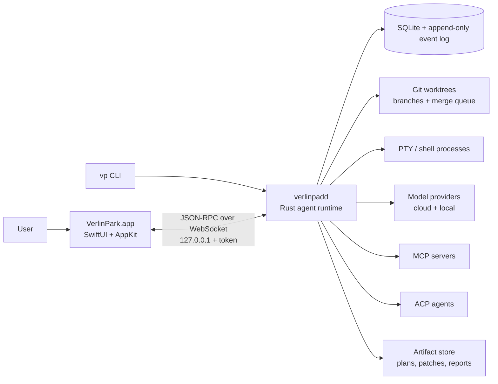

# VerlinPark

**A native macOS agentic development environment for agent teams.**

VerlinPark runs a hierarchy of coding agents in isolated Git worktrees, lets them collaborate through typed messages and shared artifacts, and makes every plan, tool call, diff, token, and permission decision inspectable and replayable.

> **Status: pre-alpha / design phase.** This repository currently contains the research, architecture, and development plan. There is no runnable app yet.

---

## Why another ADE?

Coding agents are powerful, but the workflow around them is still held together with terminal tabs, copy-pasted prompts, and hope.

- Multiple agents edit the same checkout and step on each other.
- Context is trapped in one chat window; subagents become a game of telephone.
- Token spend and tool activity are invisible until the bill arrives.
- Every agent vendor wants to own the workflow.
- Local models are treated as a second-class option.

VerlinPark is built around a different default: **agent teams should have an org chart, isolated workspaces, and a paper trail.**

It is not a chat window bolted onto an editor. It is a native control plane for planning, running, reviewing, and landing agent work.

## The three pillars

### 1. Park — a workspace for agent teams

Every task gets a Git worktree and a branch. Every department gets an objective. Every agent gets a role, a model, a budget, and a permission policy.

The default organization is a three-level department structure:

```text
Lead
├── Discovery department
│   └── Scouts (read-only research)
├── Implementation department
│   └── Builders (isolated worktrees)
├── Quality department
│   └── Verifiers (tests and review)
└── Release department
    └── Integrator (merge queue)
```

Plans are proposed by the Lead, validated by code, and executed by a DAG scheduler. Agents can talk to each other, but only through typed messages and artifact references — not by forwarding entire chat histories.

### 2. Glass Box — everything is inspectable

VerlinPark records the full session as an append-only event log:

- the plan and every revision
- every agent message, including who asked whom for what
- every LLM request and response
- every tool call, approval, and diff
- tokens, cost, latency, retries, and budget state
- every Git worktree, commit, and merge

The UI can reconstruct a session, replay it, export it, and show exactly why a change landed.

### 3. Open Bench — native, local-first, and extensible

- Native SwiftUI/AppKit UI, not a web app in a shell.
- A Rust core daemon that can run headless and be driven by a CLI.
- Cloud APIs first; any OpenAI-compatible endpoint (LM Studio, Ollama, llama.cpp) works as a local provider.
- Embedded MLX runtime planned for a later milestone.
- MCP for tools, ACP for external agents, skills and hooks for project-specific behavior.
- GPL-3.0, open protocols, no vendor lock-in.

## Architecture at a glance



The daemon owns sessions and keeps running when the app closes. The SwiftUI app is a client. The CLI is another client. The protocol is versioned and replayable.

## Planned v0.1

The first demo is a complete multi-agent feature delivery on a benchmark repository:

1. Open a repository and create a session with a goal.
2. Pick a three-level org template. Assign models and budgets manually.
3. The Lead produces a plan; the runtime validates the DAG, write scopes, fan-out, and budgets.
4. Departments execute tasks in parallel, each Builder in its own worktree.
5. Scouts produce context packets; Verifiers run tests and review; the Integrator merges into an integration branch.
6. The UI shows the Park Map, every message, every tool call, every diff, and the cost ledger.
7. The user reviews and lands the integration branch.

v0.1 is not a full IDE, not a model hub, and not a document workspace. See [docs/PLAN.md](docs/PLAN.md) for scope, milestones, and non-goals.

## Documentation

- [Development plan](docs/PLAN.md) — product thesis, scope, milestones, risks
- [Architecture](docs/ARCHITECTURE.md) — runtime, protocol, data model, security
- [Research](docs/RESEARCH.md) — competitive analysis and sources
- [Decisions](docs/DECISIONS.md) — locked architectural decisions (ADRs)

## Principles

1. **Native, not wrapped.** If it feels like a browser, we have failed.
2. **Agent teams, not chat tabs.** Organization is a first-class product surface.
3. **Glass box, not black box.** No invisible tool calls, cost, or state changes.
4. **Local-first, cloud-optional.** Your repository and traces stay on your machine by default.
5. **Manual control over magic.** The runtime advises; the user decides models, budgets, and permissions.
6. **Worktree-native.** Isolation is the default, not a feature flag.
7. **Open protocols, open source.** MCP, ACP, Git, and GPL-3.0.

## Non-goals for v1

- A general-purpose document / slides / voice assistant
- A complete IDE with debugger and full LSP stack
- A model marketplace or hosted inference service
- Windows or Linux desktop clients
- Team cloud sync or enterprise administration
- Autonomous merge to `main` without human approval

## License

VerlinPark is licensed under the **GNU General Public License v3.0 only** (`GPL-3.0-only`). See [LICENSE](LICENSE).

GPL-3.0 is incompatible with the current Mac App Store terms; the plan is direct distribution via a signed and notarized DMG and Homebrew. See [docs/PLAN.md](docs/PLAN.md#13-发布与许可).

## Inspiration

VerlinPark learns from, and is not affiliated with:

- [LM Studio Bionic](https://lmstudio.ai/) — local-first agent work with projects, sessions, skills, and model routing
- [DeepSeek Harness](https://www.deepseek.com/harness/) — everything-is-a-plugin harness architecture and trace-first developer experience
- [Zed](https://zed.dev/) — native performance, ACP external agents, parallel threads, worktree isolation
- [Conductor](https://conductor.build/) — one workspace per task, diff review, merge, archive
- [Claude Code](https://code.claude.com/) — subagents, permission modes, worktree isolation
- [LM Studio](https://lmstudio.ai/) and [MLX Swift](https://github.com/ml-explore/mlx-swift) — local inference on Apple silicon

---

## 中文简介

**VerlinPark 是 macOS 原生的 Agent 开发区（ADE）。**

它把每个任务放进独立的 Git worktree，让一个三层部门制的 Agent 团队并行工作；Agent 之间通过结构化消息和共享工件协作；所有计划、工具调用、diff、token 和权限决策都可审计、可回放、可合并。

三个支柱：

- **Park（工作区）**：项目 → 会话 → 部门 → 任务 → worktree，一任务一分支，天然并行。
- **Glass Box（玻璃盒）**：完整事件日志、Trace、成本账本、Checkpoint、逐 hunk review，不做黑盒。
- **Open Bench（开放工作台）**：SwiftUI 原生 UI + Rust Core，本地/云端模型，MCP/ACP，CLI，GPL-3.0。

当前处于设计阶段，仓库里是研究、架构和开发计划。详见 [docs/PLAN.md](docs/PLAN.md)。

## 许可

GPL-3.0-only。见 [LICENSE](LICENSE)。
