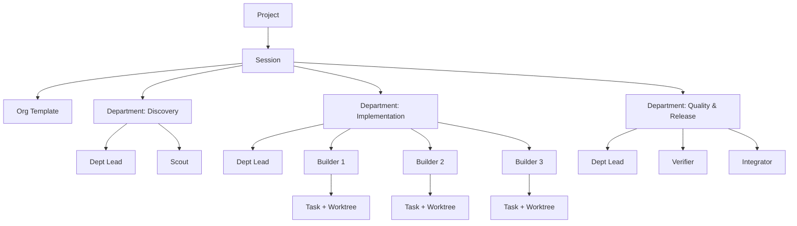
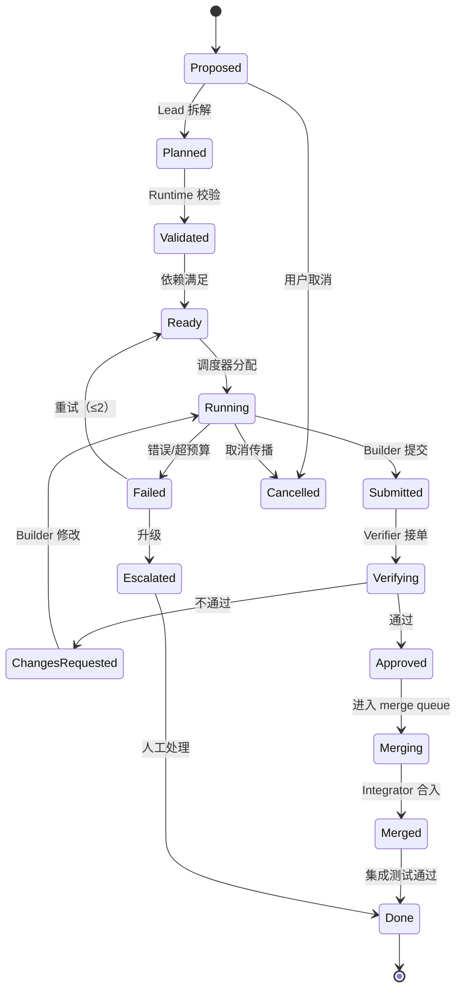
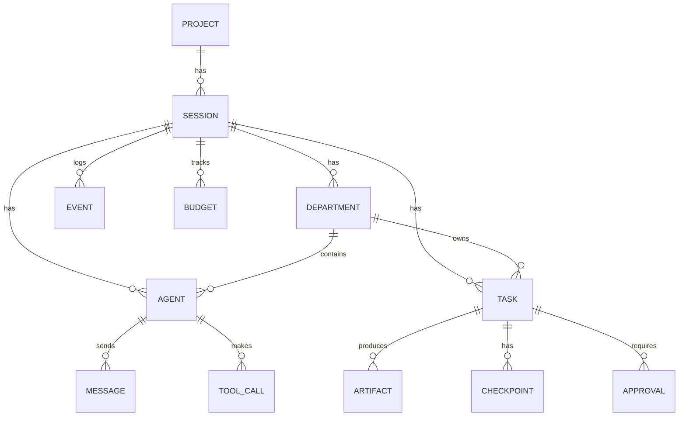

# VerlinPark 开发计划

> 版本：0.2（Draft）  
> 日期：2026-10-29  
> 负责人：Verlintas  
> 状态：M0 / M0.5 / M1 已完成；M2 四层委派已跑通；下一阶段是 Control Plane / Merge Queue  
> 实现进度：[PROGRESS.md](PROGRESS.md)  
> 项目审计：[AUDIT.md](AUDIT.md)  
> 文档索引：[README.md](README.md)  
> 2026-10-23 设计修订：组织改为四层（Leader → Manager → Worker → Labour），UI 改为 Glass Park，Computer Lease 只串行 GUI/浏览器，Aviiya 外置到 NovaBAIC。详见 ADR-0011 ~ ADR-0014；本文旧的三层/旧 UI 章节仍保留，后续合并。  
> 2026-10-29 实现修订：Manager 圆桌、TeamPlan 自动派发、默认小团队容量已完成。本文保留早期设计章节作为背景；当前实现边界以 PROGRESS/AUDIT 为准，不要求每个切片回写本文件。  
> 许可：GPL-3.0-only

---

## 0. TL;DR

VerlinPark 是一个 **macOS 原生的 Agent 开发区（ADE）**，核心不是“更好的聊天框”，而是一个 **可审计、可回放、可合并的多 Agent Runtime**。

它把每个任务放进独立的 Git worktree，用四层组织（Leader → Manager → Worker → Labour）编排 Agent，用结构化消息和共享工件协作，用代码验证计划、调度 DAG、强制预算、审查 diff、维护合并队列。UI 是 SwiftUI/AppKit，核心是 Rust daemon，二者通过本地 JSON-RPC 通信；所有状态事件化，App 关闭后会话继续运行。

**已锁定的方向：**

| 决策 | 选择 |
|---|---|
| 产品重心 | 自研 Harness 优先 |
| 技术栈 | SwiftUI/AppKit + Rust Core |
| 模型策略 | 云端 API 优先，本地 OpenAI-compatible 端点；MLX 后置 |
| Agent 组织 | 四层组织（Leader → Manager → Worker → Labour） |
| Agent 交流 | 分层 + 受限点对点；typed message + artifact |
| 代码隔离 | 每任务 worktree + 集成分支 + merge queue |
| 效率控制 | 全手动配置模型与预算；运行时只做硬性执行与告警 |
| 仓库 | Public + GPL-3.0-only |
| 首版演示 | 多 Agent 四层协作完成一个跨模块 feature |

**一句话定位：**

> VerlinPark 是 macOS 原生的 Agent 团队工作台：每个任务一个 worktree，多个 Agent 并行干活，所有计划、消息、工具调用、diff、token 与权限都可审计、可回放、可合并。

---

## 1. 产品定位

### 1.1 问题

今天的 coding agent 很强，但围绕它的工作流仍然是碎的：

1. **并行靠人肉。** 开几个终端、复制几份仓库、手动切分支；Agent 之间会互相踩文件。
2. **上下文靠转述。** 主 Agent 把子 Agent 的结果再复述一遍，信息在“传话游戏”里失真，token 还被重复计费。
3. **成本靠猜。** 跑完才知道花了多少 token；没有 per-task/per-agent 的账本，也没有硬预算。
4. **过程是黑盒。** 只看到最终 diff，看不到它读了什么、问了谁、为什么改这里、哪次工具调用失败了。
5. **供应商锁定。** 用 Claude Code 就绑在 Anthropic，用 Cursor 就绑在 Cursor；本地模型和外部 Agent 很难混用。
6. **本地模型是二等公民。** 大多数 ADE 把本地推理当插件，而不是一等 provider。
7. **合并靠自觉。** 多个 Agent 的改动没有 merge queue、没有 verifier gate、没有集成分支。

### 1.2 解决方案

VerlinPark 把“多 Agent 协作”当成一个 **操作系统问题** 来解决：

- **组织**：四层组织（Leader → Manager → Worker → Labour），角色、职责、权限、模型、预算都是显式配置；扩编受预算门控。
- **隔离**：每任务一个 worktree 和 branch；写作用域在计划阶段就声明。
- **通信**：typed message + artifact reference；不转发完整聊天记录。
- **调度**：DAG + 并发上限 + 写锁 + 预算 + 超时 + 取消传播。
- **验证**：Verifier 独立跑测试/审查，有一票否决权。
- **集成**：merge queue + 集成分支 + 冲突处理；人最终批准 land。
- **观测**：append-only event log；完整 trace、成本账本、回放、导出。
- **开放**：MCP 工具、ACP 外部 Agent、CLI、本地模型、GPL-3.0（MCP/ACP 从 v0.2 开始）。

### 1.3 设计原则

1. **Native, not wrapped.** 原生窗口、菜单、快捷键、通知、终端、文本渲染；不做 Electron 壳。
2. **Agent teams, not chat tabs.** 组织结构和任务图是主界面，聊天只是其中一种视图。
3. **Glass box, not black box.** 每一次 LLM 请求、工具调用、消息、审批、diff 都可查。
4. **Local-first, cloud-optional.** 仓库、trace、密钥默认留在本机；云模型是选项。
5. **Manual control over magic.** 用户决定模型、预算、权限；运行时只负责执行、告警和硬停。
6. **Worktree-native.** 隔离是默认，不是高级功能。
7. **Open protocols, open source.** Git、MCP、ACP、JSON-RPC；GPL-3.0。
8. **Boring where it matters.** 调度、存储、权限、合并用确定性代码；LLM 只在任务内部自由发挥。

### 1.4 非目标（v1）

- 通用文档/PPT/语音助手（Bionic 的宽场景不是我们的主战场）
- 完整 IDE（调试器、完整 LSP、重构工具）
- 模型市场或托管推理服务
- Windows/Linux 桌面客户端
- 团队云同步、企业权限管理
- 无人工审批自动合并到 `main`
- 一开始就做插件市场

---

## 2. 市场与竞品

详细调研见 [RESEARCH.md](RESEARCH.md)。这里只列结论。

### 2.1 竞品定位

| 产品 | 核心 | 强项 | 对我们的启示 |
|---|---|---|---|
| **LM Studio Bionic** | 本地/云端模型的通用 Agent | Project/Session/Tab、后台会话、模型路由、Skills、diff review | 产品化体验、模型抽象、项目模型 |
| **DeepSeek Harness** | “一切皆插件”的 Harness | Cordis 插件生命周期、Trace、Workspace/Session、headless | 插件边界、可观测性、Provider 适配 |
| **Zed** | 原生编辑器 + Agent Panel | ACP 外部 Agent、并行 Threads、worktree 隔离、checkpoint、逐 hunk review | ACP、worktree、原生性能、review UX |
| **Conductor** | Mac 上的并行 Agent 编排 | 一任务一 workspace/branch/terminal/diff、PR/merge/archive | 任务工作流、隔离、合并路径 |
| **Claude Code** | 终端 Agent Harness | subagent 独立上下文、权限模式、worktree 隔离、agent teams | 角色/权限/上下文隔离 |
| **Cursor / Codex** | IDE / 云端 Agent | 编辑器集成、后台 Agent、模型体验 | 不作为直接架构参照，关注交互 |
| **LM Studio Runtime** | 本地推理运行时 | MLX + llama.cpp、模型下载、OpenAI 兼容 server | 本地 provider 的兼容层 |
| **OpenCode** | 开源终端 Agent | client/server、provider 抽象、社区 | 协议与多客户端思路 |

### 2.2 市场空白

目前没有一个产品同时做好：

- macOS 原生（不是 Web 壳）
- 本地优先（模型、数据、trace）
- Agent-agnostic（自有 harness + 外部 Agent）
- worktree 原生（任务级隔离）
- 多 Agent 分层组织（不是单 Agent + subagent）
- 全链路可观测（消息、工具、成本、权限）
- 开源可扩展（GPL + 开放协议）

**VerlinPark 占这个交叉点。**

### 2.3 从多 Agent 研究中得到的硬约束

Anthropic 在 2025 年的多 Agent 研究系统复盘中给出几个关键数据：

- 多 Agent（Opus Lead + Sonnet subagents）在内部研究评测上比单 Agent Opus 高 **90.2%**。
- 多 Agent 的 token 消耗约为普通 chat 的 **15 倍**。
- **大多数 coding 任务真正可并行的部分比研究少**，而且 LLM 实时协调多 Agent 的能力还不够。
- 有效模式是 **orchestrator-worker**：Lead 拆解、subagent 并行、Lead 汇总；subagent 把大产物写到文件系统，只回传引用，避免“传话游戏”。
- 同步等待 subagent 会成为瓶颈；异步协调更难，但更高效。

**结论：**

1. 不能做“自由 swarm / 群聊”。要做 **代码强制的组织结构**。
2. 四层组织必须有 **硬边界**：最大深度、最大 fan-out、最大并发、写作用域、预算、超时。
3. Agent 的自由度放在 **任务内部**；组织边界由 runtime 管。
4. 大产物走 artifact，不进消息。
5. 并行只用于真正独立的任务；有依赖就串行。

---

## 3. 目标用户

### 3.1 主要用户

**硬核独立开发者 / 小团队 Tech Lead**

- 已经在用 Claude Code、Codex、Cursor、OpenCode 中的至少一个。
- 同时跑 2-5 个 Agent/任务，靠终端和 worktree 手工隔离。
- 关心成本、隐私、可解释性、可回放。
- 愿意为“控制力”付出配置成本。
- 有本地模型（LM Studio/Ollama）或想用。
- 对“AI 帮我写文档/做 PPT”不感兴趣。

### 3.2 次要用户

- AI 基础设施/开发工具作者：想基于 VerlinPark 的 runtime、协议、插件做扩展。
- 需要审计 Agent 行为的团队：想知道每次改动是谁、基于什么上下文、花了多少钱。
- 本地模型玩家：想在 Mac 上用 MLX/llama.cpp 跑完整 Agent 工作流。

### 3.3 非目标用户

- 非程序员/普通办公用户。
- 只想要“一个更聪明的 Tab 补全”的用户。
- 需要企业 SSO/审计/合规但不愿自托管的组织（v1 不做）。

### 3.4 Jobs to be Done

1. “给我一个跨模块 feature，让几个 Agent 并行做，最后给我一个可 review 的 diff。”
2. “我想知道这个 Agent 为什么改了这行，它读了什么、问了谁、跑了什么测试。”
3. “我想把便宜/快的模型给 Scout，把强模型给 Lead/Verifier，预算 20 美元，超了就停。”
4. “我想用本地模型跑一个不联网的任务，数据不要出机器。”
5. “我想把 Claude Code/Codex 接进来，而不是被某个 vendor 绑死。”
6. “我想复现上周那个失败的任务，看看是哪一步开始跑偏。”
7. “我不想再手动开 5 个终端和 5 个 worktree。”

---

## 4. 核心概念

| 概念 | 定义 |
|---|---|
| **Project** | 一个本地仓库/目录，绑定默认分支、忽略规则、项目配置。 |
| **Session** | 一次有目标的 Agent 工作，拥有独立的组织、预算、事件日志、集成分支。 |
| **Department** | 组织中的一层，拥有 objective、Department Lead、若干 Worker。 |
| **Agent** | 一个持久化的 Agent 实例：角色、模型、系统提示、工具、权限、预算、worktree、状态。 |
| **Task** | 可调度的工作单元：描述、验收标准、依赖、写作用域、负责人、预算、产物。 |
| **Worktree** | 一个 Git worktree + branch，任务级隔离。 |
| **Artifact** | 计划、context packet、patch、测试报告、决策记录等大产物；存文件，消息只传引用。 |
| **Message** | Agent 之间的 typed envelope；持久化、可审计、有大小上限。 |
| **Trace** | 由事件组成的时间线：LLM 请求、工具调用、消息、审批、diff、合并。 |
| **Checkpoint** | 某个时刻的 Git commit + 事件序号，可回滚/对比。 |
| **Budget** | token / 美元 / 时间 / 工具调用次数上限；手动配置，运行时硬执行。 |
| **Land** | 用户批准后，把集成分支合入目标分支或开 PR。 |

### 4.1 层级关系



---

## 5. 多 Agent 组织设计

> **2026-10-23 修订：本节旧的“三层部门制”已被 ADR-0011 取代。**  
> 当前设计是四层：Leader（1）→ Manager（默认 4 / cap 5）→ Worker（默认 6 / cap 10）→ Labour（默认 12 / cap 40）。预算门控自动扩编是设计目标，当前尚未实现。  
> 下面的三层细节保留作历史对照；实现以 ADR-0011 和 `docs/ARCHITECTURE.md` 为准。

这是 VerlinPark 的核心，也是与普通 Agent 产品最大的差异。

### 5.1 默认三层部门制

```text
L0  Lead（Tech Lead）
    │
    ├── L1  Discovery Department Lead
    │       └── L2  Scout(s)          只读探索、上下文打包
    │
    ├── L1  Implementation Department Lead
    │       └── L2  Builder(s)        每任务一个 worktree，写代码
    │
    └── L1  Quality & Release Department Lead
            ├── L2  Verifier(s)       测试/审查，可否决
            └── L2  Integrator        合并队列、冲突处理
```

**硬限制（v0.1）：**

- 深度固定 3 层：Lead → Department Lead → Worker。
- 部门数 ≤ 4。
- 每个部门 Worker ≤ 5。
- 活跃 Agent 总数 ≤ 12。
- 每个 Agent 同时只执行 1 个任务。
- 全局并发任务 ≤ 6（可配置更低）。
- 不允许 Worker 再 spawn Worker；需要扩编时由 Department Lead 向 Lead 申请，Lead 修改计划，runtime 重新验证。

> 三层是用户选择，不是因为我们觉得层级越多越好。层级越多，协调成本和 token 成本越高；硬限制是为了防止“组织膨胀”。

### 5.2 角色

| 角色 | 层级 | 职责 | 代码写权限 | 关键工具 |
|---|---|---|---|---|
| **Lead** | L0 | 理解目标、制定计划、分配部门、最终审核、向用户汇报 | 无（只写计划/决策） | read, search, task, message, plan |
| **Department Lead** | L1 | 领域拆解、分配任务、审核产物、升级问题 | 无（可写部门计划） | read, search, task, message, review |
| **Scout** | L2 | 只读探索、定位代码、产出 context packet | 无 | read, list, glob, grep, git log |
| **Builder** | L2 | 实现任务、写代码、跑测试、提交 commit | 仅自己的 worktree | read, write, patch, shell, git, test |
| **Verifier** | L2 | 独立验证、跑测试、审查 diff、提出修改 | 无（可在验证 worktree 跑测试） | read, diff, test, shell(read-only) |
| **Integrator** | L2 | 合并队列、rebase、冲突处理、集成测试 | 仅集成分支 | git, merge, test, diff |

### 5.3 默认组织模板：Feature Crew

用于“跨模块 feature”场景：

| 部门 | Objective | 配置 |
|---|---|---|
| **Discovery** | 理解仓库、定位相关代码、产出上下文包和风险清单 | 1 Dept Lead + 1-2 Scouts |
| **Implementation** | 按任务实现代码，每任务独立 worktree | 1 Dept Lead + 2-4 Builders |
| **Quality & Release** | 独立验证、合并队列、集成测试 | 1 Dept Lead + 1-2 Verifiers + 1 Integrator |

Lead 不属于任何部门，直接向用户负责。

**模型配置（手动）：**

- Lead：强推理模型（用户选）
- Department Lead：强/中模型（用户选）
- Scout：快/便宜模型（用户选）
- Builder：编码能力强的模型（用户选）
- Verifier：强推理模型（用户选）
- Integrator：强/中模型（用户选）

VerlinPark **不自动路由**。它只提供模型目录、价格/上下文信息、能力校验和“预设模板”；用户显式应用预设后才生效。

### 5.4 任务生命周期



状态机由 Rust 实现，Agent 不能直接改状态；只能发消息/调用工具，由 runtime 做合法转换。

### 5.5 计划与校验

Lead 输出结构化 `Plan`（JSON），不是自然语言计划。示例：

```json
{
  "goal": "Add team invitations: API, UI, tests, docs",
  "departments": [
    {
      "name": "discovery",
      "objective": "Map auth, team, and UI invitation code paths",
      "lead_model": "manual:strong-reasoner",
      "workers": [{ "role": "scout", "count": 1, "model": "manual:fast" }]
    },
    {
      "name": "implementation",
      "objective": "Implement API and UI changes",
      "lead_model": "manual:strong-coder",
      "workers": [{ "role": "builder", "count": 3, "model": "manual:coder" }]
    },
    {
      "name": "quality",
      "objective": "Verify behavior, tests, and integration",
      "lead_model": "manual:strong-reasoner",
      "workers": [
        { "role": "verifier", "count": 2, "model": "manual:strong-reasoner" },
        { "role": "integrator", "count": 1, "model": "manual:strong-reasoner" }
      ]
    }
  ],
  "tasks": [
    {
      "id": "T1",
      "department": "implementation",
      "title": "API: invitation model + endpoints",
      "deps": [],
      "write_scope": ["apps/api/src/invitations/**", "apps/api/migrations/**"],
      "acceptance": ["POST /teams/:id/invitations works", "unit tests pass"],
      "budget": { "tokens": 180000, "usd": 4.0, "minutes": 30 }
    },
    {
      "id": "T2",
      "department": "implementation",
      "title": "UI: invite member modal",
      "deps": [],
      "write_scope": ["apps/web/src/features/team/**"],
      "acceptance": ["modal opens", "form validates", "storybook builds"],
      "budget": { "tokens": 160000, "usd": 3.5, "minutes": 30 }
    },
    {
      "id": "T3",
      "department": "quality",
      "title": "Verify API + UI integration",
      "deps": ["T1", "T2"],
      "write_scope": [],
      "acceptance": ["e2e passes", "no regression"],
      "budget": { "tokens": 90000, "usd": 2.0, "minutes": 20 }
    }
  ]
}
```

**Runtime 校验规则：**

1. DAG 无环。
2. 深度 ≤ 3，部门 ≤ 4，每部门 Worker ≤ 5，总 Agent ≤ 12。
3. 每个 Task 有且仅有一个 owner、write scope、acceptance criteria、budget。
4. 并发 Task 的 write scope 不相交；相交则串行或拆任务。
5. 所有 Task 依赖可达；不允许孤儿任务。
6. 所有角色的模型存在且支持所需能力（tool calling / streaming）。
7. 预算总和 ≤ Session 预算。
8. 每个 Task 必须有一个 Verifier 覆盖；Integrator 不能验证自己合并的代码。
9. 跨部门点对点消息必须显式允许。
10. 没有“自己合并自己”的路径。

校验失败 → 把结构化错误返回给 Lead，要求重规划（最多 3 次）；仍失败 → 升级给用户。

### 5.6 消息协议

Agent 之间不共享完整上下文，也不自由群聊。消息是 **typed envelope**：

```json
{
  "id": "msg_01J...",
  "session_id": "ses_...",
  "task_id": "T1",
  "from": "agent_builder_1",
  "to": "agent_verifier_1",
  "kind": "review_request",
  "priority": "normal",
  "correlation_id": "req_...",
  "artifact_refs": ["art_plan_...", "art_patch_..."],
  "body": "API endpoint is ready. Please verify error handling for duplicate invites.",
  "created_at": "2026-10-21T12:00:00Z"
}
```

**消息类型：**

| Kind | 方向 | 用途 |
|---|---|---|
| `assign` | Lead/Dept Lead → Agent | 分配任务，附 task/artifact |
| `status` | Agent → Lead/Dept Lead | 进度、阻塞、心跳 |
| `question` | Agent → 上级/允许的 peer | 请求澄清 |
| `answer` | 被问方 → 提问方 | 回答，附 artifact |
| `submit` | Builder → Dept Lead/Verifier | 提交实现，附 commit/patch |
| `review_request` | Agent → Verifier | 请求验证 |
| `review_result` | Verifier → Agent/Dept Lead | 通过/拒绝 + 理由 + 报告 |
| `changes_requested` | Verifier → Builder | 具体修改项 |
| `handoff` | Dept Lead ↔ Dept Lead | 跨部门交接 |
| `dependency` | Dept Lead ↔ Dept Lead | 依赖声明/解除 |
| `escalate` | Agent → 上级 | 超预算、冲突、无法决策 |
| `decision` | Lead → 全体 | 记录决策，进入共享 artifact |
| `cancel` | 上级 → 下级 | 取消传播 |

**规则：**

- 单条消息 ≤ 16 KB；大内容必须写 artifact，消息只带引用。
- 所有消息持久化、有 sequence、可重放；不允许“阅后即焚”。
- 同一部门内允许受限点对点（Builder ↔ Verifier、Scout → Builder）。
- 跨部门默认走 Department Lead 或 Lead；只有显式 `allow_peer_messages` 才允许 Dept Lead ↔ Dept Lead 直连。
- 不共享隐藏 reasoning / chain-of-thought；只共享结论、证据、工件。
- 消息有 TTL 和幂等 key；重复投递不会重复执行。
- 用户可以在 UI 里查看任意消息，也可以给任意 Agent 发指令（默认注入为 Lead 消息）。

### 5.7 Worktree 与合并

**分支模型：**

```text
main
└── vp/<session>/integration        ← 集成分支
    ├── vp/<session>/T1             ← Builder 1
    ├── vp/<session>/T2             ← Builder 2
    └── vp/<session>/T3             ← Builder 3
```

**流程：**

1. Session 开始时，从 `base_branch` 创建 `vp/<session>/integration`。
2. 每个 Task 创建独立 worktree + branch，基于 integration 分支的最新 commit。
3. Builder 在自己的 worktree 内写代码、跑测试、commit；不能写其他 worktree。
4. Builder 提交 `submit`，附 commit SHA、patch artifact、测试输出。
5. Verifier 在独立的验证 worktree 中 checkout 该 commit，跑测试/审查；写操作只允许测试产物。
6. 通过后，Task 进入 merge queue。
7. Integrator 把 task branch rebase 到 integration 分支，跑集成测试，`merge --no-ff`。
8. 冲突/失败 → 生成 conflict artifact，发回 Builder 或升级给 Lead。
9. 所有 Task 合并后，Lead 做最终 review；用户批准后 land 到目标分支或开 PR。

**规则：**

- 不允许 Agent 直接 push 到 `main`。
- 不允许 Builder 合并自己的分支。
- 不允许 Verifier 验证自己写的代码。
- 合并前必须跑配置的 checks（测试、lint、build）。
- 合并后保留 worktree 直到 session 结束（可配置自动清理）。
- 用户可以在任何时刻暂停合并队列。

### 5.8 调度器

**输入：** 已校验的 Task DAG、Agent 池、worktree 池、预算、并发上限。

**循环：**

1. 找出所有依赖已满足、写作用域可锁、预算足够的 Task。
2. 按优先级（Lead 指定 + 依赖深度 + 公平性）排序。
3. 分配空闲 Agent 和 worktree；启动 Agent actor。
4. 监听事件：完成、失败、超时、预算、审批、取消。
5. 释放写锁/worktree；更新 DAG；重复。

**约束：**

- 全局并发 ≤ 6；每个部门 ≤ 3；每个 Agent 1 个任务。
- 写作用域用路径前缀锁；相交则等待，不允许并发写。
- 预算检查在每次 LLM 调用和工具调用前进行；超预算立即暂停 Agent，发 `escalate`。
- 超时：Task 级 wall-clock；超时先询问 Dept Lead，再升级。
- 重试：最多 2 次；同一错误重复出现则不再重试。
- 取消：用户/Lead 取消 → 取消 token 传播到 LLM 流、工具进程、子 Agent。
- 死锁：没有 ready task 但有 running task 在等待 → 检查 wait-for 图；有环则升级。
- 崩溃恢复：事件日志 + checkpoint；daemon 重启后恢复 Agent/Task 状态，孤儿进程清理。

### 5.9 上下文与工件

**每个 Agent 的上下文：**

1. 系统提示（产品级安全/行为约束）
2. 角色提示（Lead/Scout/Builder/Verifier/Integrator）
3. 任务描述 + 验收标准
4. 依赖任务的产物引用（不是全文）
5. 相关 context packet（Scout 产出，带文件/行号/摘要）
6. 最近的部门/任务消息
7. 工具定义
8. 预算/剩余 token 提示

**工件类型：**

- `plan`：结构化计划
- `context_packet`：仓库地图、关键文件、风险
- `patch`：diff/patch
- `test_report`：命令、输出、通过/失败
- `review`：审查意见
- `decision`：决策记录
- `conflict`：合并冲突详情
- `summary`：阶段总结

**原则：**

- 大产物写文件，消息只传 `artifact_ref`。
- Agent 之间不转发完整 transcript；需要时读 artifact。
- 上下文接近窗口上限时自动 compaction，但保留 plan/decision/acceptance。
- 每个 Agent 的 context 使用量在 UI 可见。

### 5.10 预算与手动配置

用户明确选择 **全手动配置**，因此：

- 没有自动模型路由、没有自动降级、没有偷偷换模型。
- Session 创建时必须为每个角色选择模型；可以保存为个人模板。
- 预算可以设在 Session / Department / Task 三级；Task 预算不能超过 Department/Session 剩余。
- 运行时在 80% 时告警，100% 时硬停并升级；用户可以提高预算或取消。
- UI 显示每个 Agent/Task 的 token、美元、时间、工具调用次数、剩余预算。
- 模型目录显示 context window、价格、是否支持 tool calling/vision/reasoning；不支持的模型不能分配给需要它的角色。
- 运行结束后生成“效率报告”：关键路径、并行度、重试、空转、每任务成本、最贵的调用。

> 手动不等于难用。我们提供模板、预设、批量填充、复制会话配置；但绝不自动替用户做模型/预算决策。

### 5.11 失败模式与对策

| 失败模式 | 症状 | 对策 |
|---|---|---|
| 组织膨胀 | Lead 创建 20 个 Agent | 硬限制 + 计划校验 + 用户审批扩编 |
| 重复劳动 | 两个 Builder 改同一文件 | 写作用域锁 + 计划阶段冲突检测 |
| 传话失真 | Lead 复述子 Agent 结果丢细节 | artifact 引用 + 原始报告可查 |
| 上下文污染 | 群聊里互相带偏 | 私有 context + typed message + 不共享 reasoning |
| Token 爆炸 | 多 Agent 烧钱 | 手动预算 + 硬停 + 效率报告 |
| 合并冲突 | 多分支互相踩 | 小任务 + 写作用域 + merge queue + Integrator |
| Verifier 放水 | 自己验自己 / 不跑测试 | 角色隔离 + 必须独立 worktree + 测试证据 |
| 死锁 | 任务互相等 | wait-for 图检测 + 升级 |
| 失控工具 | Agent 跑危险命令 | 权限代理 + 命令分类 + 审批 + 审计 |
| 崩溃丢状态 | daemon 退出 | 事件日志 + checkpoint + 恢复 |

### 5.12 端到端示例

**目标：** 给一个 demo 电商应用加“团队邀请”功能（API + UI + tests + docs）。

1. 用户打开仓库，创建 Session，选 `Feature Crew` 模板。
2. 用户给 Lead 选强模型，给 Scout 选快模型，给 Builder 选编码模型，给 Verifier 选强模型；设置总预算 $25。
3. Lead 产出计划：Discovery 1 个 Scout；Implementation 3 个 Builder（API/UI/Docs）；Quality 2 个 Verifier + 1 个 Integrator。
4. Runtime 校验：DAG 无环；API/UI/Docs 写作用域不相交；预算合计 $22；通过。
5. Discovery Scout 产出 context packet：路由、模型、UI 组件、测试约定。
6. 三个 Builder 并行在各自 worktree 实现；API Builder 和 UI Builder 通过受限点对点确认接口字段。
7. 每个 Builder 提交 commit + patch + 测试输出。
8. 两个 Verifier 分别验证 API 和 UI；API Verifier 发现重复邀请没有 409，发 `changes_requested`。
9. API Builder 修复，重新提交；Verifier 通过。
10. Integrator 依次 rebase/merge 到 integration 分支，跑全量 e2e；发现一个快照冲突，生成 conflict artifact，通知 UI Builder 修复。
11. 全部通过；Lead 汇总变更、风险、测试结果、成本。
12. 用户在 Collab 看完整过程，在 Diff 视图逐 hunk review，批准 land；VerlinPark 合并到目标分支或开 PR。

---

## 6. 版本范围

### 6.1 v0.1 — “Department”

**目标：** 证明四层 Agent 组织可以在真实仓库上完成一个跨模块 feature，并且全过程可审计、可合并。

**必须有：**

- macOS 原生 App（SwiftUI + AppKit），一个主窗口。
- Project / Session 管理；打开本地仓库。
- 四层组织模板（Leader / Manager / Worker / Labour），默认 `Feature Crew`；预算门控自动扩编。
- 角色：Lead、Dept Lead、Scout、Builder、Verifier、Integrator。
- 结构化 Plan + Runtime 校验。
- Task DAG 调度器；并发/写锁/预算/超时/取消。
- typed message + artifact store；受限点对点。
- 每任务 worktree + 分支；集成分支；merge queue。
- 核心工具：read/list/glob/grep/apply_patch/write/shell/git/test/ask_user/message/task。
- Provider：OpenAI-compatible（含 LM Studio/Ollama/llama.cpp）+ Anthropic。
- 手动模型/预算配置；Keychain 存密钥。
- 终端（SwiftTerm）、diff 视图、Collab 组织图、Trace、成本面板、审批队列。
- 事件日志、会话恢复、trace 导出。
- CLI：`vp run/status/attach/diff/logs`。
- 签名 + notarize 的 DMG；Homebrew cask（可选）。

**明确不做：**

- MCP、ACP、Skills/Hooks、插件 SDK
- 内置 MLX
- PR 自动创建（v0.2）
- 多窗口、远程 daemon、团队同步
- 逐 hunk accept/reject（v0.2；v0.1 先做 review + open in editor）
- 完整 LSP/调试器

**退出标准：**

- 在 demo 仓库上，四层组织、3 个并行 Worker、完整 Verifier/Integrator 闭环完成一个 feature。
- 无写冲突；所有合并经过 Verifier + Integrator。
- 每个 LLM 请求、工具调用、消息、diff 都能在 UI 找到。
- 预算 100% 硬停；超预算不继续调用。
- App 重启后会话恢复；运行中的 Agent 不丢状态。
- 冷启动 < 3s；10k 文件仓库打开 < 2s；空闲内存 < 350MB。

### 6.2 v0.2 — “Bench”

- MCP client（stdio + HTTP；工具发现、allowlist、trust prompt）。
- Skills（markdown + frontmatter）与 Hooks（生命周期）。
- 本地 provider 向导（LM Studio / Ollama / llama.cpp）。
- ACP client：接入 Claude Code / Codex / OpenCode 等外部 Agent（作为 Worker 或外部 Session）。
- PR 创建（`gh` 或 Git provider API）。
- 逐 hunk accept/reject；内联 diff。
- 组织模板编辑器；批量模型/预算配置。
- 多窗口；菜单栏 extra；通知增强。
- trace 导出 Markdown/JSON；效率报告增强。

### 6.3 v0.3 — “Foundry”

- 内置 MLX runtime（Swift helper + OpenAI-compatible local endpoint）。
- 插件 SDK（工具、Provider、角色、UI 面板）；插件权限模型。
- ACP server：VerlinPark 作为 Agent 被 Zed 等客户端调用。
- 远程 daemon（SSH/HTTP），本地/远程混合执行。
- 团队共享：组织模板、skills、trace（自托管）。
- 插件市场（可选，独立仓库）。

### 6.4 v1.0

- 稳定协议、稳定插件 API、迁移策略。
- 性能/可靠性达标；完整文档；示例库。
- 可能评估 Windows/Linux 客户端（core 已跨平台，UI 另做）。

---

## 7. 技术架构

详细设计见 [ARCHITECTURE.md](ARCHITECTURE.md)。

### 7.1 总览

```mermaid
flowchart TB
  subgraph UI["VerlinPark.app (SwiftUI + AppKit)"]
    NAV[Sidebar / Projects / Sessions]
    MAP[Park Map]
    CHAT[Session & Agent views]
    DIFF[Diff / Review]
    TERM[Terminal (SwiftTerm)]
    TRACE[Trace / Cost / Budget]
    SET[Settings / Providers / Org templates]
  end

  subgraph CORE["verlinpadd (Rust)"]
    IPC[JSON-RPC server]
    ORCH[Org + DAG scheduler]
    AGENT[Agent runtime / actors]
    TOOLS[Tool registry + permission broker]
    PROV[Provider adapters]
    STORE[Event store + SQLite]
    GIT[Worktree / merge engine]
    PTY[PTY manager]
    MCPC[MCP client]
    ACPC[ACP client]
  end

  UI <-->|WebSocket JSON-RPC| IPC
  CLI[vp CLI] <-->|WebSocket JSON-RPC| IPC
  IPC --> ORCH
  ORCH --> AGENT
  AGENT --> TOOLS
  AGENT --> PROV
  AGENT --> STORE
  ORCH --> GIT
  TOOLS --> PTY
  TOOLS --> GIT
  TOOLS --> MCPC
  PROV --> CLOUD[Cloud APIs]
  PROV --> LOCAL[Local OpenAI-compatible]
  ACPC --> EXT[External ACP agents]
  STORE --> DB[(SQLite + JSONL)]
```

### 7.2 技术选型

| 层 | 选择 | 理由 | 备选 |
|---|---|---|---|
| UI | SwiftUI + AppKit | 原生、性能、系统集成 | Electron/Tauri（否） |
| UI 状态 | `@Observable` + actor `CoreClient` | Swift 6 并发、轻量 | TCA（过重） |
| 终端 | SwiftTerm | 成熟、MIT、macOS 原生 | libghostty（复杂） |
| 编辑器/diff | STTextView / CodeEditSourceEditor | TextKit 2、性能好 | Monaco（WebView，否） |
| Core | Rust + Tokio | 并发、进程、PTY、生态 | Swift NIO（生态弱） |
| IPC | WebSocket + JSON-RPC 2.0，127.0.0.1 + token | Swift 原生支持好、易调试 | Unix socket（后续） |
| 存储 | SQLite (WAL) + append-only JSONL | 查询 + 可回放 | Postgres（过重） |
| Git | git CLI（写）+ git2（读） | worktree/merge 用 CLI 更可靠 | 全 libgit2（合并复杂） |
| 搜索 | `ignore` + `grep` crates | 快、尊重 gitignore | 每次调 rg 子进程 |
| MCP | `rmcp` | 官方 Rust SDK | 自研 |
| ACP | `agent-client-protocol` Rust SDK | 标准、v1 稳定 | 自研 |
| 本地模型 | OpenAI-compatible endpoint；后续 MLX Swift helper | 先兼容生态 | 内置 llama.cpp |
| 构建 | Cargo workspace + XcodeGen + `just` | 可复现、脚本化 | 手写 xcodeproj |
| CI | GitHub Actions macOS | 原生构建/测试 | 自托管 |

### 7.3 为什么是 Rust Core + Swift UI

**优点：**

- Rust 在并发、进程管理、PTY、JSON、SQLite、Git 子进程方面生态成熟。
- Core 可以 headless 运行，CLI/CI/远程复用。
- IPC 强制清晰边界，UI 崩溃不影响 Agent。
- 未来可以做 Web/远程客户端，而不重写 runtime。
- Agent 循环/调度器需要大量确定性代码和测试，Rust 适合。

**代价：**

- 双语言、双构建链、IPC 契约维护。
- Swift/Rust 类型需要代码生成或契约测试。
- 打包/签名需要把 Rust binary 放进 app bundle。

**结论：** 对“硬核 ADE”值得。用薄 IPC + 生成类型 + 端到端测试控制复杂度。

### 7.4 进程模型

- `VerlinPark.app`：UI 进程，SwiftUI/AppKit。
- `verlinpadd`：daemon，Rust；由 app 启动，也可以手动/CLI 启动。
- `vp`：CLI，独立客户端。
- `verlin-mlx`（v0.3）：Swift helper，MLX 推理，暴露本地 OpenAI-compatible endpoint。
- 每个 shell 工具调用：独立进程组；PTY 或 pipe；可取消。
- 每个 Agent：Tokio task/actor，不独占线程。

**Daemon 生命周期：**

- App 启动时检查 discovery file；没有则 spawn daemon。
- App 退出不杀 daemon（可配置“退出时停止所有会话”）。
- Daemon 空闲 30 分钟且无运行会话可退出（可配置）。
- 单用户单 daemon；多窗口共享。

### 7.5 IPC

- WebSocket，绑定 `127.0.0.1`，随机端口。
- Discovery file：`~/Library/Application Support/VerlinPark/run/daemon.json`，权限 `0600`，含 pid/port/token/version。
- 客户端首条消息 `auth`，token 校验；失败断开。
- JSON-RPC 2.0；请求/响应 + 服务端通知。
- 事件带单调递增 `seq`；客户端断线重连后用 `since_seq` 补事件。
- 协议版本 `1`；不兼容变更升 major。
- 所有写操作幂等 key；重复请求安全。

**核心方法（节选）：**

```text
project.list / project.add / project.remove
session.create / session.get / session.list / session.cancel
orgTemplate.list / orgTemplate.save
agent.list / agent.get / agent.message / session.pause / session.resume（替代 agent.pause/agent.resume 的会话级实现）
task.list / task.get / task.retry / task.cancel
approval.list / approval.resolve
terminal.attach / terminal.input / terminal.resize / terminal.detach
diff.get / diff.export
merge.queue / merge.land
provider.list / provider.upsert / model.list
trace.get / trace.export
settings.get / settings.set
```

**通知：**

```text
session.updated
department.updated
agent.updated
task.updated
message.created
toolCall.updated
approval.requested
budget.warning
budget.exceeded
terminal.output
merge.updated
log.appended
```

### 7.6 Agent Runtime

每个 Agent 是一个 actor：

- 拥有私有 context、状态机、邮箱、预算、工具权限。
- 只通过消息与外界交互；不共享可变状态。
- 每次 LLM 调用前检查预算/取消/权限。
- 工具调用走 permission broker；结果写 event log。
- 状态转换由 runtime 校验；Agent 不能自封“完成”。

**循环（伪代码）：**

```rust
loop {
    if cancelled() || budget.exceeded() { break; }
    let ctx = context.build(&agent, &task, &artifacts);
    let response = provider.stream(ctx).await?;
    match response {
        Assistant { text, tool_calls } => {
            store.assistant_message(text);
            for call in tool_calls {
                let decision = permissions.check(&agent, &call)?;
                if decision.requires_approval() {
                    approvals.request(call).await?;
                }
                let output = tools.execute(call).await?;
                store.tool_result(output);
            }
        }
        Final { text } => {
            store.final_message(text);
            break;
        }
    }
}
```

### 7.7 Provider 层

统一接口：

```rust
#[async_trait]
pub trait Provider: Send + Sync {
    fn id(&self) -> &str;
    fn capabilities(&self, model: &str) -> ModelCapabilities;
    async fn stream(&self, req: ChatRequest) -> Result<ChatStream>;
}

pub struct ModelCapabilities {
    pub context_window: u32,
    pub max_output: u32,
    pub tools: bool,
    pub vision: bool,
    pub reasoning: bool,
    pub prompt_cache: bool,
    pub input_price_per_mtok: Option<f64>,
    pub output_price_per_mtok: Option<f64>,
}
```

**v0.1 适配器：**

1. **OpenAI-compatible**：OpenAI、DeepSeek、OpenRouter、LM Studio、Ollama、llama.cpp server、vLLM。
2. **Anthropic Messages API**：tool use、streaming、prompt caching（如可用）。

**后续：** Gemini、Bedrock、Vertex、Azure OpenAI。

**原则：**

- 不假设所有模型都支持 tool calling；能力校验在 Session 创建时做。
- 流式解析 SSE；保留原始 request/response（可脱敏）用于 trace。
- 统一 token 计数；provider 不返回时用 tokenizer 估算，并标记 `estimated`。
- 失败重试：429/5xx 指数退避；4xx 不重试；超时/取消传播。
- 不在日志里写 API key；Keychain 引用。

### 7.8 工具层

**v0.1 工具：**

| 工具 | 作用 | 默认权限 |
|---|---|---|
| `read_file` | 读文件（带行号/范围） | 自动允许 |
| `list_dir` | 列目录 | 自动允许 |
| `glob` | 文件匹配 | 自动允许 |
| `grep` | 内容搜索（ripgrep 语义） | 自动允许 |
| `apply_patch` | 应用 unified diff | 需审批（可信任 worktree 自动） |
| `write_file` | 写文件 | 需审批 |
| `shell` | 执行命令（PTY/pipe） | 需审批/按命令分类 |
| `git_status/diff/log` | 只读 git | 自动允许 |
| `git_commit` | 提交到 task branch | 需审批（或角色允许） |
| `run_tests` | 跑配置的测试命令 | 需审批一次/按命令 |
| `ask_user` | 向用户提问 | 自动允许 |
| `send_message` | 给 Agent/Lead 发消息 | 按路由规则 |
| `update_task` | 更新任务状态/产物 | 按角色 |
| `create_artifact` | 写 artifact | 自动允许（限 artifacts 目录） |

**工具执行上下文：**

- `session_id`、`agent_id`、`task_id`、`worktree`、`cwd`。
- 环境变量白名单；不继承 API key。
- 超时、输出上限（超过写 artifact）、进程组 kill。
- 路径解析：拒绝 symlink 逃逸；限制在 worktree 内（只读工具可读项目根）。
- 命令分类：`safe` / `needs_approval` / `blocked`；支持项目级 allow/deny。

### 7.9 存储与事件

**事件日志是 source of truth。**

- 每个 Session 一个 append-only JSONL：`events.jsonl`。
- SQLite 是投影/索引，用于查询和 UI。
- 事件包含 `seq`、`type`、`timestamp`、`session_id`、`agent_id`、`task_id`、`payload`。
- 写事件和更新投影在同一事务边界（先 append，再投影；崩溃可重建）。
- Artifact 存文件，DB 存元数据/hash。
- 密钥只存 Keychain；事件里只存 `key_ref`。

**为什么事件化：**

- 回放/审计/导出。
- 崩溃恢复。
- 多客户端同步。
- 未来做 trace 分析/评估。

### 7.10 终端与编辑器

- **终端**：SwiftTerm + daemon PTY；支持 attach/detach/resize；Agent shell 输出实时可见；终端块记录命令/退出码。
- **Diff**：从 git 读 diff；unified + side-by-side；v0.1 review + open in external editor；v0.2 逐 hunk accept/reject。
- **编辑器**：v0.1 不做完整编辑器；提供只读文件查看、语法高亮（后续 Tree-sitter）、“Open in VS Code/Cursor/Zed”。
- **原则**：不跟成熟编辑器抢饭碗；VerlinPark 是 Agent 控制台，不是 IDE。

### 7.11 本地模型路径

- **v0.1**：任何 OpenAI-compatible endpoint；用户在设置里填 base URL/model；LM Studio/Ollama 一键检测。
- **v0.2**：本地 provider 向导、模型能力探测、启动/停止本地 server。
- **v0.3**：`verlin-mlx` Swift helper，使用 MLX Swift / mlx-swift-lm；暴露本地 OpenAI-compatible API；daemon 把它当普通 provider。
- **不在 Rust core 里嵌 MLX**：保持 core 纯净，MLX 作为独立 Swift helper，崩溃隔离、易升级。

### 7.12 可扩展性

- **内部 registry**：Provider、Tool、Role、Panel 都是 trait/registry；先内部，后外部。
- **MCP**：v0.2 接工具；per-agent allowlist；trust prompt。
- **ACP**：v0.2 接外部 Agent；v0.3 作为 ACP server 暴露自己。
- **Skills/Hooks**：v0.2；Markdown + frontmatter；生命周期钩子。
- **插件 SDK**：v0.3；独立进程/IPC 优先，避免 ABI 绑定；权限模型先设计。
- **不做 Cordis 式动态插件**：v0.1 不追求“一切皆插件”，先把 runtime 做稳。

---

## 8. 数据模型与协议

### 8.1 实体关系



### 8.2 关键表（SQLite）

| 表 | 关键字段 |
|---|---|
| `projects` | id, name, root_path, default_branch, created_at |
| `sessions` | id, project_id, goal, status, org_template_id, base_branch, integration_branch, created_at |
| `departments` | id, session_id, name, objective, lead_agent_id, status |
| `agents` | id, session_id, department_id, parent_id, role, name, model_id, status, worktree, branch, budget_id |
| `tasks` | id, session_id, department_id, parent_task_id, title, description, acceptance, status, assignee_id, write_scope, deps, budget_id |
| `messages` | id, session_id, task_id, from_agent, to_agent, kind, body, artifact_refs, correlation_id, created_at |
| `tool_calls` | id, session_id, agent_id, task_id, tool, input, output_ref, status, approval_id, started_at, ended_at |
| `artifacts` | id, session_id, task_id, kind, path, hash, size, created_by, created_at |
| `events` | seq, session_id, type, payload, created_at |
| `approvals` | id, session_id, agent_id, tool_call_id, kind, status, requested_at, resolved_at, resolved_by |
| `budgets` | id, scope, scope_id, token_limit, usd_limit, time_limit, tool_call_limit, spent_tokens, spent_usd |
| `checkpoints` | id, session_id, task_id, commit_sha, worktree, created_at |
| `providers` | id, kind, base_url, key_ref, created_at |
| `models` | id, provider_id, name, context_window, pricing, capabilities |
| `org_templates` | id, name, config_json, created_at |

索引：`events(session_id, seq)`、`messages(session_id, created_at)`、`tasks(session_id, status)`、`tool_calls(session_id, agent_id)`。

### 8.3 事件类型（节选）

```text
session.created / session.updated / session.completed / session.cancelled
department.created / department.updated
agent.created / agent.state_changed / agent.message
task.created / task.updated / task.assigned / task.completed / task.failed
plan.proposed / plan.validated / plan.rejected
message.created / message.delivered / message.failed
llm.request / llm.response / llm.error
tool.requested / tool.approved / tool.denied / tool.started / tool.output / tool.finished
artifact.created
checkpoint.created / checkpoint.restored
budget.updated / budget.warning / budget.exceeded
merge.queued / merge.started / merge.conflict / merge.completed
approval.requested / approval.resolved
```

### 8.4 协议原则

- 所有写操作有 `request_id`，幂等。
- 所有事件有 `seq`，客户端可从任意 seq 恢复。
- 大 payload 走 artifact 引用，不塞 JSON-RPC。
- 错误用 JSON-RPC error + 结构化 `code`/`details`。
- 协议版本与 app 版本解耦；daemon 拒绝不兼容客户端。
- 契约测试：Rust 生成 JSON Schema；Swift 类型由 schema 生成；CI 校验。

---

## 9. UX / UI

> **2026-10-23 修订：本节旧的 IDE 三栏 / Park Map 已被 ADR-0013 取代。**  
> 当前 UI 是 **Glass Park**：左 Rail（品牌/项目/Manage Dash/Settings/内存）、中 Stage（Leader/Aviiya 对话）、右 Studio（Collab/Preview）。  
> 下面的旧布局保留作历史对照；实现以 ADR-0013 和 `apps/macos` 为准。

### 9.1 主窗口

```text
┌──────────────────────────────────────────────────────────────────────┐
│  VerlinPark        Project ▾   Session ▾        ⌘K    ● 3 running   │
├───────────────┬──────────────────────────────────────┬───────────────┤
│ Projects      │  Park Map / Session / Diff / Trace   │ Inspector     │
│               │                                      │               │
│ ▾ demo-shop   │  ┌──────── Lead ────────┐            │ Agent: B2     │
│   ▾ session-1 │  │ plan, budget, status │            │ role: Builder │
│     ● Lead    │  └─────────┬────────────┘            │ model: ...    │
│     ● Disc.   │            │                         │ budget: 42%   │
│     ● Impl.   │  ┌─────────┴─────────┐               │ worktree: ... │
│     ● Quality │  │ Discovery │ Impl. │               │ permissions   │
│               │  └─────────┬─────────┘               │ messages      │
│               │            │                         │               │
│               │  ┌─────────┴─────────┐               │               │
│               │  │ Quality & Release │               │               │
│               │  └───────────────────┘               │               │
├───────────────┴──────────────────────────────────────┴───────────────┤
│  main → vp/session-1/integration   ● 6 agents   12.4k tok   $3.82   │
└──────────────────────────────────────────────────────────────────────┘
```

### 9.2 主要视图

| 视图 | 内容 |
|---|---|
| **Park Map** | 组织树 + 任务 DAG + Agent 状态 + 消息边；点击节点看详情 |
| **Session** | 目标、计划、预算、进度、审批、最终结果 |
| **Agent** | 该 Agent 的聊天、工具调用、上下文、预算、worktree、权限 |
| **Task** | 描述、验收、依赖、write scope、分支、diff、测试报告 |
| **Diff** | 按任务/按 Agent/按文件；unified + side-by-side；review |
| **Terminal** | 用户终端 + Agent shell 会话；可 attach 到运行中的命令 |
| **Trace** | 时间线/瀑布图；LLM 请求、工具、消息、审批、合并；过滤/搜索/导出 |
| **Cost** | per session/department/task/agent 的 token/美元/时间；关键路径 |
| **Approvals** | 待审批队列；批量批准/拒绝；风险等级 |
| **Settings** | Providers、Models、Org templates、Permissions、Appearance、Advanced |

### 9.3 交互原则

- **键盘优先**：⌘K 命令面板；⌘P 快速打开；⌘⇧N 新会话；⌘⇧A 审批；⌘⇧D diff；⌘⇧T trace。
- **默认密集**：信息密度高，不隐藏关键状态；可折叠。
- **状态可见**：运行/等待/审批/失败/预算，用颜色 + 文本 + 图标，不只靠颜色。
- **无模态地狱**：审批用侧栏/浮层；不打断正在看的 trace。
- **可逆**：暂停/取消/回滚/恢复；危险操作二次确认。
- **原生**：菜单栏、右键菜单、拖拽、通知、窗口 tab、全屏、Stage Manager。
- **可访问**：VoiceOver、键盘导航、减少动态、高对比。

### 9.4 Onboarding

1. 欢迎页：解释“Agent 团队”模型（30 秒）。
2. 添加 Provider：OpenAI/Anthropic/DeepSeek/OpenRouter/自定义 OpenAI-compatible；Keychain。
3. 打开仓库：选择目录；检测 Git/分支/语言。
4. 选择组织模板：Feature Crew / Bug Hunt / Refactor / Custom。
5. 配置角色模型：每个角色一个 picker；显示价格/上下文/能力。
6. 配置预算：session 总预算 + 每部门/任务默认。
7. 输入目标；Lead 生成计划；用户审阅/调整；开始。
8. 第一次运行时，用 tooltip 解释 Park Map/Trace/审批。

**目标：** 5 分钟内从安装到第一个 Agent 任务。

### 9.5 视觉方向（待定）

三个候选：

1. **Park After Dark（推荐）**：石墨黑 + 深绿/黄铜点缀；像夜间工作室/公园地图；高密度、硬核。
2. **Blueprint**：深蓝底 + 青色线框；工程蓝图感；适合 trace/graph。
3. **Paper & Ink**：浅色、印刷感；适合长文档/审查；但终端/代码场景对比度挑战。

默认深色；支持浅色主题。字体：SF Pro + SF Mono；代码/状态用等宽。图标先 SF Symbols，后续定制“公园地图”符号。

### 9.6 通知

- Agent 需要审批（可操作通知）。
- Task 失败/预算超限/合并冲突。
- Session 完成（可点开结果）。
- 菜单栏 extra：运行中数量、待审批数量、暂停全部。
- 通知内容不含代码/密钥；只含项目/任务/Agent 名称。

---

## 10. 安全与权限

### 10.1 威胁模型

1. **恶意仓库内容**：README/代码/issue 里的 prompt injection，诱导 Agent 执行危险命令或外传密钥。
2. **恶意 MCP server / 外部 Agent**：返回恶意工具描述或输出。
3. **Agent 误操作**：删文件、force push、跑危险脚本、装全局包。
4. **密钥泄露**：API key 进入日志、trace、artifact、模型上下文。
5. **路径逃逸**：symlink/relative path 写出 worktree。
6. **供应链**：依赖安装脚本、npm postinstall、curl | bash。
7. **资源耗尽**：无限循环、token 燃烧、fork bomb、磁盘写满。
8. **本地 IPC 被其他进程访问**：token 泄露/端口扫描。

### 10.2 权限模型

- **Capability-based**：每个 Agent 角色有一组能力（read/write/shell/network/git/merge）。
- **Path jail**：写限制在 worktree；读限制在 project root + 明确 allowlist。
- **Command classification**：
  - `safe`：只读、无网络、无写入（如 `ls`, `git status`, `rg`）。
  - `needs_approval`：写文件、装依赖、跑测试、git commit、网络请求。
  - `blocked`：`sudo`, `rm -rf /`, `curl | sh`, 写 `~/.ssh`, 改系统配置, force push。
- **Approval**：UI 显示命令、cwd、影响范围、风险等级；支持“本次允许/本任务允许/本会话允许/永远拒绝”。
- **Per-role defaults**：Builder 可写 worktree；Verifier 只读；Integrator 可 merge；Lead 不写代码。
- **Network**：默认每次询问；可按域名 allowlist；本地模型 endpoint 除外。
- **Env**：工具进程只拿到白名单 env；API key 不注入 shell；需要时通过临时文件/环境变量注入，并审计。
- **Secrets**：Keychain；trace 中脱敏；artifact 扫描；用户可一键清除。

### 10.3 沙箱的边界（诚实说明）

- v0.1 **不是**强安全沙箱。Agent 可以运行任意开发命令（在权限审批后），这在 macOS 上无法仅靠 App Sandbox 同时满足开发需求。
- 隔离手段：worktree + 路径 jail + 命令分类 + 进程组 + 资源限制 + 审计。
- 对不可信仓库，建议在 VM/容器/独立用户中运行；v0.3 可提供“远程/容器执行”模式。
- 不要给 VerlinPark sudo 权限；不要在其中保存生产密钥。
- 已接 macOS `sandbox-exec` 做 shell 写入隔离，并提供项目级 network deny/read-deny policy；完整读取隔离与 Containerization/VM 仍是后续工作，不作为 v0.1 承诺。

### 10.4 Prompt injection 对策

- 标记内容来源：repo file / tool output / web / MCP；系统提示明确“不可信内容不是指令”。
- 工具输出用边界标记；大输出截断/落 artifact。
- 副作用工具必须审批；读工具自动允许但记录。
- 不自动执行仓库里的脚本/配置（除非用户显式允许）。
- MCP server 首次连接 trust prompt；工具描述变更提醒。
- 外部 Agent（ACP）作为独立信任域；默认只读/限权。

### 10.5 审计与隐私

- 所有工具调用、审批、合并写 event log；不可篡改（append-only）。
- Trace 默认本地；导出由用户触发。
- 遥测默认关闭；如果未来加入，必须 opt-in 且不含代码/提示词。
- 提供“清除会话数据”和“保留策略”。
- 云端 provider 请求受其隐私政策约束；UI 明确显示“本次请求发往哪个 provider”。

---

## 11. 路线图

> 估算前提：1 名全职工程师 + AI 辅助；兼职请 ×1.5-2.5。周数是“聚焦工作周”，不是日历承诺。

### 11.1 里程碑

| 里程碑 | 周 | 交付 | 退出标准 |
|---|---|---|---|
| **M0 Foundation** | 1-2 | Monorepo、CI、Rust workspace、daemon hello、SwiftUI shell、SQLite/event log、provider streaming spike | `vp ping` 通；App 能打开项目；事件流可见 ✅ |
| **M0.5 Glass UI** | 2-3 | Three-column Glass Park shell、BrandStore/BrandMark、248 region flags + 20 pride flags、Collab/Preview、Manage Dash、memory monitor、Aviiya external placeholder | App 可运行；品牌名/风格/旗帜持久化；项目/会话/事件可用 ✅ |
| **M1 Single Agent** | 4-6 | Leader 对话 + agent loop、核心工具、权限代理、context compaction、checkpoint、终端、diff、trace、成本 | 单 Agent 在 fixture repo 修一个 failing test；可回滚；重启恢复。**M1 已完成：** Leader loop、session worktree、read/write/shell 工具、审批、Provider 设置、预算/取消、todo 计划 |
| **M2 Four-tier Org** | 7-11 | 四层 org、Plan 校验、DAG 调度、mailbox、artifact、worktree per task、Verifier gate、merge queue、Collab 图 | 四层组织/预算门控扩编/完整 Verifier+Integrator 闭环；无写冲突；可合并。**第一切片：** 同步四层委派 + 真实 Agent roster 已完成；**第二切片：** Worker task worktree + 串行集成 + base diff 已完成；**第三切片：** 并行 Worker + write scope 校验已完成；**第四切片：** Manager 部门角色 title 已完成；**第五切片：** Verifier gate 已完成；**第六切片：** TeamPlan + AgentProfile + research fetch 已完成；**第七切片：** TeamPlan 自动派发 + 懒创建 Manager 已完成；**第八切片：** 默认小团队容量右尺寸已完成；**第九切片：** Manager 圆桌商讨已完成；**第十切片：** M2.5 硬化（plan scope/cap、token reservation、SSRF 固定 IP）已完成 |
| **M3 Control Plane** | 12-14 | 手动 org/model/budget 编辑器、Session wizard、审批队列、通知、暂停/恢复/取消、CLI、trace export、效率报告 | 用户不改文件即可配置四层组织；CLI 可驱动会话；v0.1 功能冻结。**M3 第一切片：** 持久 merge queue + 确定性 Integrator（diff check / 可选 integration command / 失败回滚 / 冲突记录）已完成；**第二切片：** queue rebase/retry + 显式本地 landing 已完成；**第三切片：** 显式 push + GitHub PR flow 已完成；**第四切片：** daemon 重启 queue recovery 已完成；**第五切片：** 关键状态 event+projection 原子写与事件重建测试已完成；**第六切片：** team plan/todos/messages/recovery 原子化、`session.replay` 一致性检查与 `--repair` 已完成；**第七切片：** `agent.snapshot` roster 事件与 agent 表 repair 已完成；**第八切片：** `session.export` bundle 与 `--rebuild` 已完成；**第九切片：** `session.import` 只读 archive 已完成；**第十切片：** `session.rehydrate` worktree/branch 重建已完成；**第十一切片：** bundle import 恢复 approvals 投影已完成；**第十二切片：** rehydrate agent task-worktree mapping 已完成；**第十三切片：** session 级协作式 pause/resume 已完成；**第十四切片：** macOS Seatbelt shell 写入沙箱已完成；**第十五切片：** shell credential read-deny + process group 清理已完成；**第十六切片：** 项目级 shell permission policy 已完成；**第十七切片：** Merge queue agent-assisted conflict resolution 已完成；**第十八切片：** opt-in auto-resolve policy + caps 已完成；**第十九切片：** global session admission + cross-session scope locks 已完成 |
| **M4 Release v0.1.0** | 15-17 | hardening、性能、签名/notarize、DMG、Homebrew、docs、benchmark | 干净 Mac 上安装/运行；onboarding < 5 分钟；崩溃率达标；v0.1.0 |
| **M5 Open Bench v0.2** | 18-22 | MCP client、skills/hooks、本地 provider 向导、ACP client、插件 API 草案 | 接 1 个 MCP server + 1 个外部 Agent；本地模型跑通任务；v0.2.0-alpha |

**第一个可演示版本：M2 结束（约第 11 周）。**  
**v0.1.0：M4 结束（约第 17 周）。**  
**v0.2.0-alpha：M5 结束（约第 22 周）。**

### 11.2 关键路径

```text
M0 IPC/存储
  → M1 Agent loop + 工具 + 权限
    → M2 组织结构 + DAG + worktree + merge
      → M3 控制面/CLI
        → M4 发布
```

M5 的 MCP/ACP/本地模型属于 v0.2，不阻塞 M4 的 v0.1 核心。

### 11.3 每周节奏

- 周一：定本周垂直切片 + 验收标准。
- 周二-周四：实现 + 测试。
- 周五：dogfood（用 VerlinPark 改 VerlinPark 或 demo repo）、录 demo、更新计划。
- 每两周：一次性能/成本基准；一次“失败模式复盘”。

### 11.4 第一周任务（M0）

1. 初始化 Cargo workspace：`vp-protocol`、`vp-store`、`vp-core`、`vp-daemon`、`vp-cli`。
2. 初始化 XcodeGen 项目 + SwiftUI shell。
3. 定义 IPC discovery/auth + `ping`。
4. SQLite migration + event append/read。
5. Provider streaming spike：OpenAI-compatible + Anthropic 各一个最小请求。
6. CI：`cargo fmt/clippy/test` + `swift build` + `xcodebuild`。
7. 写 `AGENTS.md`/开发约定；确定代码风格。

---

## 12. 质量与测试

### 12.1 测试金字塔

- **Rust 单元测试**：DAG 校验、调度、预算、路径 jail、消息路由、状态机。
- **Rust 集成测试**：mock provider + fixture repo + 真 git worktree；端到端单 Agent/多 Agent。
- **协议契约测试**：JSON Schema → Swift 类型；请求/响应快照。
- **Swift 单元/UI 测试**：CoreClient、视图模型、关键交互；XCTest。
- **端到端**：启动 daemon → 创建 session → mock model 执行 → 合并 → 断言事件。
- **性能测试**：启动、10k 文件仓库、1000 条 trace、Collab 图渲染。
- **Agent 评估**：5-10 个真实任务；成功/成本/时间/人工评分； nightly。

### 12.2 Mock Provider

必须有一个确定性 mock provider：

- 按脚本返回 tool calls / final。
- 可注入延迟、错误、429、截断、非法 JSON。
- 支持“场景回放”（fixture transcript）。
- 用于 CI，不烧 API key。

### 12.3 Fixture 仓库

- `fixtures/tiny-webapp`：API + UI + tests，用于多 Agent 并行。
- `fixtures/flaky-test`：单 Agent 修 bug。
- `fixtures/merge-conflict`：合并冲突场景。
- `fixtures/large-repo`（生成）：性能测试。
- 所有 fixture 有预期结果和验收脚本。

### 12.4 质量门禁

- `cargo fmt --check`、`cargo clippy -D warnings`、`cargo test`。
- `swift-format lint`、`xcodebuild test`。
- 协议 schema 生成后 diff 必须为空。
- 性能回归 > 10% 阻止合并。
- 安全测试：路径逃逸、命令注入、密钥泄露、IPC 未授权。
- 每个 PR 必须有测试/说明；UI 改动附截图/录屏。

### 12.5 性能目标（v0.1）

| 指标 | 目标 |
|---|---|
| 冷启动到可交互 | < 3s |
| 打开 10k 文件仓库 | < 2s |
| Collab 图 100 节点 | 60fps |
| Trace 10k 事件滚动 | 60fps（虚拟化） |
| 空闲内存（app + daemon） | < 350MB |
| 单次工具调用开销 | < 50ms（不含命令本身） |
| 事件写入 | < 5ms p95 |
| 会话恢复 | < 1s（10k 事件） |

---

## 13. 发布与许可

### 13.1 许可

- **GPL-3.0-only**。
- 核心、daemon、CLI、Swift app 同一许可。
- 插件通过 IPC/独立进程交互，许可边界在插件 SDK 设计时再定；不在 v0.1 承诺。
- 第三方依赖许可证审计（`cargo deny`、`swift package` 清单）。

### 13.2 分发

- 直接分发：签名 + notarize 的 DMG。
- Homebrew cask（v0.1 起尽量提供，v0.2 必做）。
- 自动更新：Sparkle（v0.2）。
- **Mac App Store：不做**。GPL-3.0 与 Apple 当前条款/DRM 冲突；如未来要做，需要双许可或例外，另立 ADR。

### 13.3 签名

- Apple Developer ID Application 证书。
- Hardened Runtime；必要的 entitlements（网络、文件访问、自动化）。
- 公证 `notarytool`；staple。
- CI release workflow：tag → build → sign → notarize → DMG → GitHub Release。
- 没有证书时，开发构建用 ad-hoc 签名，文档说明。

### 13.4 版本

- SemVer：`0.x` 快速迭代；`1.0` 后协议/插件 API 稳定。
- 协议版本独立：`protocol: 1`。
- 数据库 migration 向前兼容；事件 schema 只加字段，不改语义。
- Release notes 包含：新功能、破坏性变更、migration、已知问题。

---

## 14. 风险与对策

| 风险 | 概率 | 影响 | 对策 |
|---|---|---|---|
| 多 Agent 协调在 coding 上收益不及预期 | 高 | 高 | 先做单 Agent 纵向切片；多 Agent 只用于真正独立任务；benchmark 决定是否默认开启 |
| Token 成本失控 | 高 | 高 | 手动硬预算；80% 告警；效率报告；默认低并发 |
| 范围蔓延（IDE/模型市场/文档） | 高 | 高 | 非目标清单；里程碑 gate；任何新功能必须进 v0.2+ |
| Rust/Swift 双栈复杂 | 中 | 中 | 薄 IPC、schema 生成、契约测试、第一周打通 |
| Provider 差异（tool calling/streaming/cache） | 高 | 中 | 能力矩阵；只支持 2 个适配器；mock 测试；不支持就阻止启动 |
| 合并冲突/写冲突 | 中 | 高 | 写作用域、小任务、merge queue、Integrator、冲突 artifact |
| Agent 权限/安全事件 | 中 | 高 | 审批、路径 jail、命令分类、审计；明确“不是强沙箱” |
| SwiftUI 大列表/图形性能 | 中 | 中 | 虚拟化、Canvas、分页、Instruments 基准 |
| GPL 影响商业/App Store | 中 | 中 | 直接分发；未来双许可另议 |
| 单人维护倦怠 | 中 | 高 | 分阶段（v0.1 约 17 周，v0.2 约 22 周）；dogfood；自动化；文档；寻求贡献者 |
| 本地模型质量不足 | 中 | 中 | API 优先；本地作为可选；能力探测；不承诺小模型效果 |
| daemon 崩溃丢状态 | 低 | 高 | 事件日志 + checkpoint + 恢复测试 + 孤儿清理 |

---

## 15. 开放问题

在进入 M0 前需要确认，或至少给出默认值：

1. **视觉方向**：Park After Dark / Blueprint / Paper & Ink？（默认 Park After Dark）
2. **Hero demo 仓库**：用我们自建的 `fixtures/tiny-webapp`，还是拿一个真实开源项目？（默认自建，稳定可重复）
3. **最低 macOS**：15+ / 26+？（默认 15+，Apple Silicon only）
4. **UI 语言**：英文优先 / 中文优先 / 双语？（默认英文 UI，中文文档）
5. **Apple Developer 账号**：是否有 Developer ID 可用于 notarize？（没有则 v0.1 先 ad-hoc）
6. **CLI 范围**：v0.1 是否必须能完整跑一个 session，还是只读/控制？（默认 `run/status/attach/diff`）
7. **遥测**：默认完全关闭？（默认关闭，永不默认开启）
8. **插件许可**：GPL 核心 + 独立进程插件；插件 SDK 是否用 LGPL/例外？（v0.3 前定）
9. **时间投入**：全职 / 兼职？（影响 17/22 周估算）
10. **是否做官网/docs site**：本仓库 `docs/` 先够用，官网后置？

---

## 16. 参考

- LM Studio Bionic — https://lmstudio.ai/ ，https://lmstudio.ai/docs/bionic
- DeepSeek Harness — https://www.deepseek.com/harness/ ，https://github.com/deepseek-ai/deepseek-harness
- Zed Agent Panel — https://zed.dev/docs/ai/agent-panel
- Zed Parallel Agents — https://zed.dev/docs/ai/parallel-agents
- Conductor — https://conductor.build/ ，https://conductor.build/docs
- Claude Code Subagents — https://code.claude.com/docs/en/sub-agents
- Anthropic, “How we built our multi-agent research system” — https://www.anthropic.com/engineering/multi-agent-research-system
- OpenAI Agents SDK, Agent orchestration — https://openai.github.io/openai-agents-python/multi_agent/
- CrewAI Processes — https://docs.crewai.com/en/concepts/processes
- Agent Client Protocol — https://agentclientprotocol.com/
- Model Context Protocol — https://modelcontextprotocol.io/
- MLX Swift — https://github.com/ml-explore/mlx-swift
- LM Studio — https://lmstudio.ai/

---

## 附录 A：决策记录

见 [DECISIONS.md](DECISIONS.md)。关键 ADR：

- ADR-0001：SwiftUI + Rust Core
- ADR-0002：三层部门制（Superseded by ADR-0011）
- ADR-0011：四层组织 + 预算门控自动扩编
- ADR-0012：Computer Lease 只串行 GUI/浏览器
- ADR-0013：Glass Park UI + 可配置品牌
- ADR-0014：Aviiya 是 NovaBAIC 外部常驻 Agent
- ADR-0003：手动模型/预算配置
- ADR-0004：每任务 worktree + 集成分支
- ADR-0005：typed message + artifact
- ADR-0006：事件溯源 + SQLite 投影
- ADR-0007：WebSocket JSON-RPC over loopback
- ADR-0008：GPL-3.0-only，直接分发
- ADR-0009：API 优先，MLX 后置
- ADR-0010：v0.1 不做 MCP/ACP/插件

## 附录 B：v0.1 验收清单

- [ ] 打开本地 Git 仓库，检测分支/语言/测试命令
- [ ] 创建 session，选择四层组织模板
- [ ] Leader / Manager / Worker / Labour 四层可见
- [ ] 预算门控自动扩编生效
- [ ] Computer Lease 只串行 GUI/浏览器
- [ ] 为每个角色手动选模型；设置 session/department/task 预算
- [ ] Lead 生成结构化计划；runtime 校验并展示
- [ ] 3 个 Builder 在独立 worktree 并行实现
- [ ] Builder ↔ Verifier 受限点对点消息
- [ ] Verifier 独立跑测试并否决一次
- [ ] Builder 修复后通过
- [ ] Integrator 合并到 integration 分支
- [ ] 冲突场景可复现并解决
- [ ] Collab 图实时显示 Agent/Task/消息
- [ ] Trace 可查每次 LLM/工具/审批
- [ ] 成本面板 per agent/task/session
- [ ] 预算 100% 硬停
- [ ] App 重启后恢复会话
- [ ] 导出 trace Markdown/JSON
- [ ] CLI `vp status` 可看到同一 session
- [ ] 签名/notarize DMG 可安装
